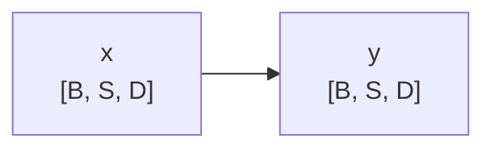

# 贡献指南

感谢你愿意为 **Hand-torn Code for LLM Interviews（大模型面试手撕代码大全）** 添砖加瓦 🎉

这个仓库有两份产物，来自同一份源码：

- **文档** —— GitHub 上直接读的 `docs/*.md`
- **站点** —— GitHub Pages 上的交互式网页（[在线浏览](https://zeng-yirong.github.io/awesome-llm-interview-code/)）

所以一道题要同时存在于"给人读的 markdown"和"给站点用的 TS 数据"两处，`scripts/check-flow.mjs` 会比对这两处是否一致。**这是本仓库最容易踩坑的地方**，动手前先读一遍[硬性约束](#硬性约束)。

---

## 我能贡献什么

| 想做的事 | 怎么提 |
|---|---|
| 新增一道 LLM 算法题 | 按[新增一道题](#新增一道题)改 4 个文件，提 PR |
| 修正题目里的错误（公式、代码、表述） | 直接改对应的 `.md` + `problems.ts`，提 PR |
| 补充面试要点、改进讲解 | 同上 |
| 有个想法/想问某题 | [开 issue](../../issues/new/choose)，**不用写代码** |

> 💡 只想提议题目、不想动手：用「新增算法题目」模板开 issue，写清算法名 + 为什么值得考 + 你设想的实现思路即可，会有 maintainer 接手。

---

## 新增一道题

一道题在仓库里分散在 **4 个位置**，漏改一个 `npm run check` 就会失败：

| # | 文件 | 改什么 |
|---|---|---|
| 1 | `docs/<分类目录>/<slug>.md` | 写题目文档（固定 5 个小节） |
| 2 | `src/data/problems.ts` | 加一条 `Problem` 记录 |
| 3 | `scripts/check-flow.mjs` 的 `DOC_OF` | 注册 `'<id>': 'docs/<分类>/<slug>.md'` |
| 4 | `README.md` 的题目总览表 | 加一行（注意 `rowspan`，见下） |

### 第 0 步：起名

- **id**：`<分类前缀>-<slug>`，例如 `attn-flash`、`loss-dpo`
- **文件名**：英文小写 + 连字符，例如 `flash-attention.md`
- **分类**：沿用下面已有目录和前缀

| 分类目录 | id 前缀 | | 分类目录 | id 前缀 |
|---|---|---|---|---|
| `docs/01-attention/` | `attn-` | | `docs/08-peft/` | `peft-` |
| `docs/02-normalization/` | `norm-` | | `docs/09-efficient/` | `eff-` |
| `docs/03-position/` | `pos-` | | `docs/10-inference/` | `infer-` |
| `docs/04-ffn/` | `ffn-` | | `docs/11-sampling/` | `sample-` |
| `docs/05-loss/` | `loss-` | | `docs/12-architecture/` | `arch-` |
| `docs/06-optimizer/` | `opt-` | | `docs/13-basics/` | `basics-` |
| `docs/07-rl/` | `rl-` | | | |

**要开新分类？** 除了新建目录，还要改 `src/data/problems.ts` 顶部的 `Category` union，并在 `README.md` 总览表里新增一个分组。

### 第 1 步：写文档

`docs/<分类目录>/<slug>.md` —— 5 个 H2 小节，标题（含 emoji）**必须完全一致**，`check-flow` 按标题定位内容：

````markdown
# 中文名 (English Name)

> 一句话描述 —— 会同步到站点的卡片副标题

## 📌 原理与思想

### 核心概念
一段话说清这个算法是什么、为什么需要它。会同步到站点的 `principle` 字段。

### 核心思想
这段（可以多条列表）会同步到站点的「核心思想」分节。

### 算法步骤
1. 第一步
2. 第二步

## 📐 核心公式

```math
\text{YourFormula}(x)=\frac{a}{b}
```

## 📊 张量流程图



## 💻 代码实现

```python
import torch

def your_algo(x):
    return x
```

## 🎯 面试要点

- **要点一**: 说明
- **要点二**: 说明
````

> 参考已有的题：[docs/13-basics/activation.md](docs/13-basics/activation.md) 是结构最干净的一篇。

### 第 2 步：加数据

在 `src/data/problems.ts` 的 `problems` 数组里加一条。字段含义：

```ts
{
  id: 'attn-your-algo',           // 与第 0 步一致
  title: 'Your Algo',             // 英文名（卡片上显示）
  titleCn: '你的算法',            // 中文名
  category: 'Attention',          // 必须是 Category union 里的取值
  hot: 3,                         // 面试热度 1~3（🔥 ~ 🔥🔥🔥）
  difficulty: 3,                  // 实现难度 1~5（⭐ ~ ⭐⭐⭐⭐⭐）
  oneLiner: '一句话描述',          // 与文档 `>` 引用行一致
  principle: '核心概念那段',       // 与文档 `### 核心概念` 一致
  principleSections: [            // 与文档 `### 核心思想` / `### 算法步骤` 一致
    { title: '核心思想', items: ['……'] },
    { title: '算法步骤', items: ['第一步', '第二步'] },
  ],
  formula: String.raw`$$ ... $$`, // 与文档 ```math 围栏一致（写法见约束 2）
  flowDiagram: String.raw`...`,   // 与文档 ```mermaid 围栏逐字节一致
  code: String.raw`...`,          // 与文档 ```python 围栏一致
  keyPoints: ['**要点一**: 说明', '**要点二**: 说明'],  // 条数与文档面试要点一致
  source: 'original',             // 自己写的用 'original'
}
```

> 注意：`formula` 字段内部用 `$$` 分隔多段公式，但**文档里必须写成 ` ```math ` 围栏**——
> 两种写法互为映射，原因见约束 2。

### 第 3 步：注册文档映射

在 `scripts/check-flow.mjs` 的 `DOC_OF` 里加一行，否则校验直接报 `映射表里没有对应文档`：

```js
const DOC_OF = {
  // ...
  'attn-your-algo': 'docs/01-attention/your-algo.md',
};
```

### 第 4 步：上总览表

在 `README.md` 的「📋 题目总览」表里加一行。该表用 `rowspan` 把同类题目合并成一格：

```html
<td rowspan="7" align="left">👁️ Attention</td>
```

**给某个分类新增题目时，要把它那一格的 `rowspan` 数字 +1。**

---

## 硬性约束

这几条是 `npm run check` 会强制执行的，违反即 CI 失败。

1. **文档和 TS 必须同源。** 校验脚本会逐字比对：张量流程图、核心公式、`oneLiner`、原理首段、原理分节、面试要点条数。做法是**先写好文档，再复制粘贴进 `problems.ts`**，两边各写一遍必然对不上（标点风格允许有差异，措辞不允许）。

2. **公式在文档里用 ` ```math ` 围栏，不要用 `$$`。** 这是为了绕开 GitHub 的 markdown 反斜杠转义——`$$` 里的 `\\` 在 GitHub 上会被吃掉。**别改回 `$$`。**

3. **公式里不能用会被 GitHub 渲染器拒收的宏。** 已知黑名单在 `scripts/check-flow.mjs` 的 `GITHUB_BANNED_MACROS`：`\operatorname`（用 `\text{}` 代替）、`\newcommand`、`\def`、`\tag`、`\href`、`\color`、`\tfrac`/`\dfrac` 等。黑名单是按踩过的坑维护的，不保证完整——**加新宏之前，先去 GitHub 上打开文档目视确认公式渲染出来了**。

4. **张量流程图用 ` ```mermaid ` 围栏，不要画 ASCII 框线字符**（`│├└┘─` 等会被校验拒绝）。mermaid 能否渲染由本地渲染验证（mermaid-cli + Chrome），CI 只查结构。

5. **一道题一个 PR。** 除非是同一个笔误的批量修正，否则别把多道题塞进一个 PR，review 会很痛苦。

6. **别动 `main` 分支**，一律走 fork → 分支 → PR。`main` 受保护，且合并到 `main` 会自动触发 GitHub Pages 部署。

---

## 本地自检

提交前请跑一遍，CI 跑的就是这两条：

```bash
npm install
npm run check        # 文档 ↔ TS 一致性 + 公式渲染 + 流程图语法
npm run typecheck    # TypeScript 类型检查
```

想在浏览器里看效果：

```bash
npm run dev          # http://localhost:3000
```

`npm run check` 是只读的，只打印报告，不会改你的文件。

---

## PR 提交清单

- [ ] 文档写好了，5 个 H2 小节标题一字不差
- [ ] `problems.ts` 里加了条目，内容是从文档**复制**过去的
- [ ] `check-flow.mjs` 的 `DOC_OF` 里注册了 id
- [ ] `README.md` 总览表加了行，`rowspan` 数字已更新
- [ ] `npm run check` 和 `npm run typecheck` 本地通过
- [ ] 公式在 GitHub 上预览确认能渲染（尤其是用了新宏时）

---

## 关于社区投票

每道题在 GitHub 上有一个带 `vote` 标签的票箱 issue（👍 热度高 / 👎 热度低），票数会显示在站点卡片上。

**新增题目时你什么都不用做** —— 合并到 `main` 后，[sync-votes.yml](.github/workflows/sync-votes.yml) 会自动给新题开票箱（最迟等下一次定时同步，6 小时内）。票箱由 [scripts/sync-votes.mjs](scripts/sync-votes.mjs) 按题目 id 认领，别手工建、也别删已有的。

票数只作展示，**不会**改动 `problems.ts` 里的 `hot` 字段。

---

## 关于 License

本项目以 [MIT](LICENSE) 协议开源。你提交的贡献将同样以 MIT 协议发布。