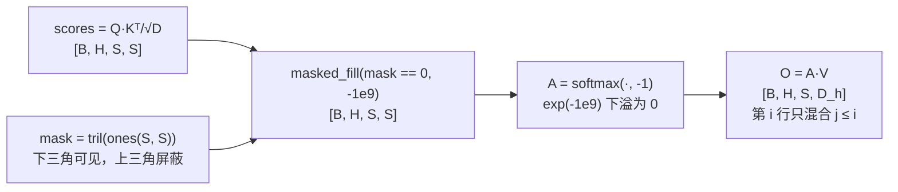

# 因果掩码 (Causal Mask)

> 下三角矩阵，防止看到未来信息

## 📌 原理与思想

### 核心概念
在 decoder 中使用下三角矩阵作为 mask，使得位置 i 只能关注位置 ≤i 的 token。这是自回归生成的基础，相比无 mask 的注意力，确保模型在训练时不会"看到未来"。

### 核心思想
通过下三角矩阵屏蔽未来位置的信息，使每个位置只能 attend 到当前及之前的 token。被屏蔽的位置填充 -inf，softmax 后变为 0，从而实现因果约束。

### 算法步骤
1. 创建下三角矩阵：mask = torch.tril(torch.ones(S, S))
2. 调整维度：mask = mask.unsqueeze(0).unsqueeze(0) → [1, 1, S, S]
3. 在注意力计算中应用：scores.masked_fill(mask == 0, -inf)
4. Softmax 归一化：attn = softmax(scores)

## 📐 核心公式

```math
M_{ij}=\begin{cases}1, & j\le i\\[2pt] 0, & j>i\end{cases}
\qquad
S'_{ij}=S_{ij}-\infty\,(1-M_{ij})
```

```math
A=\text{softmax}(S'),\qquad A_{ij}=0\ \text{ for }\ j>i
```

## 📊 张量流程图



## 💻 代码实现

```python
import torch

def create_causal_mask(seq_len, device='cpu'):
    """创建因果掩码 (下三角)"""
    mask = torch.tril(torch.ones(seq_len, seq_len, device=device))
    return mask.unsqueeze(0).unsqueeze(0)  # [1, 1, S, S]

# 在 attention 中使用
def attention_with_causal_mask(q, k, v):
    B, H, S, D = q.shape
    mask = create_causal_mask(S, device=q.device)
    
    scores = torch.matmul(q, k.transpose(-2, -1)) / (D ** 0.5)
    scores = scores.masked_fill(mask == 0, float('-inf'))
    attn = torch.softmax(scores, dim=-1)
    return torch.matmul(attn, v)

# 测试
if __name__ == "__main__":
    mask = create_causal_mask(4)
    print(mask)
    # tensor([[[[1., 0., 0., 0.],
    #          [1., 1., 0., 0.],
    #          [1., 1., 1., 0.],
    #          [1., 1., 1., 1.]]]])
```

## 🎯 面试要点

- **torch.tril**: 生成下三角矩阵
- **被屏蔽位置填 -inf**: softmax 后为 0
- **decoder-only (GPT)**: 全程使用 causal mask
- **训练时可用 causal mask 并行计算所有位置的 loss**
- **面试常问**: 为什么训练时可以并行？因为 causal mask 保证了每个位置只能看到之前的 token
- **推理时**: 每步只有 1 个 token，掩码自动失效 —— 训练与推理走的是同一套代码

