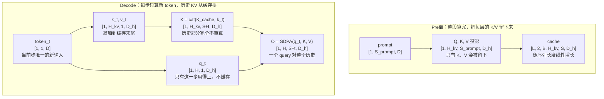

# KV Cache

> 缓存历史 KV，避免自回归重复计算

## 📌 原理与思想

### 核心概念
自回归生成时，每步只处理新 token，但需要与所有历史 token 做注意力。KV Cache 缓存历史的 K/V，避免重复计算。相比每步重新计算所有 token 的 O(N²) 复杂度，KV Cache 将其降至 O(N)，是推理加速的核心技术。

### 核心思想
空间换时间：缓存历史 token 的 K/V，每步只计算新 token 的 K/V，然后与缓存拼接。代价是额外的显存占用 O(L × H × Dh)。

### 算法步骤
1. **Prefill 阶段**：处理整个 prompt，计算并缓存所有 KV
2. **Decode 阶段**：每步只处理 1 个新 token
3. 计算新 token 的 Q, K, V
4. 拼接历史 KV：K = cat(K_cache, K_new)
5. 计算注意力：attn(Q, K, V)
6. 更新 cache，输出下一个 token

## 📐 核心公式

```math
\text{KV cache}=2\,n_{\text{layers}}\,n_{\text{kv}}\,S\,D_h\,b
```

```math
\text{LLaMA 2 70B:}\quad 2\times 80\times 8\times 4096\times 128\times 2\ \mathrm{B}=80\ \mathrm{GB}
```

```math
\text{decode}: \quad K\leftarrow\text{concat}(K,\,k_{\text{new}}),\qquad
V\leftarrow\text{concat}(V,\,v_{\text{new}})
```

```math
\text{no cache}: \sum_{t=1}^{S}t=O(S^{2}),\qquad
\text{cache}: O(S)\ \text{per step}
```

## 📊 张量流程图



## 💻 代码实现

```python
import torch
import torch.nn as nn
import torch.nn.functional as F
import math

class KVCacheAttention(nn.Module):
    def __init__(self, d_model, n_heads):
        super().__init__()
        self.h, self.dh = n_heads, d_model // n_heads
        self.wq = nn.Linear(d_model, d_model, bias=False)
        self.wk = nn.Linear(d_model, d_model, bias=False)
        self.wv = nn.Linear(d_model, d_model, bias=False)
        self.wo = nn.Linear(d_model, d_model, bias=False)

    def forward(self, x, kv_cache=None):
        """
        x: [batch, seq_len, d_model]
        kv_cache: (cached_k, cached_v) 各为 [B, H, past_len, Dh]
        """
        B, S, _ = x.shape
        q = self.wq(x).view(B, S, self.h, self.dh).transpose(1, 2)
        k = self.wk(x).view(B, S, self.h, self.dh).transpose(1, 2)
        v = self.wv(x).view(B, S, self.h, self.dh).transpose(1, 2)

        if kv_cache is not None:
            k = torch.cat([kv_cache[0], k], dim=2)
            v = torch.cat([kv_cache[1], v], dim=2)
        new_cache = (k, v)

        scores = torch.matmul(q, k.transpose(-2, -1)) / math.sqrt(self.dh)
        if S > 1:
            past_len = k.size(2) - S
            causal = torch.tril(
                torch.ones(S, k.size(2), dtype=torch.bool, device=x.device),
                diagonal=past_len)
            scores = scores.masked_fill(~causal, float('-inf'))
        out = torch.matmul(F.softmax(scores, dim=-1), v)
        out = out.transpose(1, 2).contiguous().view(B, S, -1)
        return self.wo(out), new_cache

# 测试
if __name__ == "__main__":
    B, D, H = 1, 512, 8
    torch.manual_seed(0)
    attn = KVCacheAttention(D, H)
    
    tokens = torch.randn(B, 15, D)
    ref, _ = attn(tokens)
    
    def check(name, outs, start):
        """分步算出来的那几段，必须和一次性前向逐位对上"""
        got = torch.cat(outs, dim=1)
        err = (got - ref[:, start:start + got.size(1)]).abs().max().item()
        print(f"{name}: 与前向参照的最大误差 {err:.1e}")
    
    out, cache = attn(tokens[:, :10])
    print(f"Prefill output: {out.shape}")
    print(f"Cache K shape: {cache[0].shape}")
    check("Prefill", [out], 0)
    
    outs = []
    for t in range(10, 13):
        out, cache = attn(tokens[:, t:t+1], kv_cache=cache)
        outs.append(out)
    print(f"Decode output: {outs[0].shape}")
    print(f"Cache K shape: {cache[0].shape}")
    check("Decode", outs, 10)
    
    out, cache = attn(tokens[:, 13:15], kv_cache=cache)
    print(f"Chunked prefill output: {out.shape}")
    print(f"Cache K shape: {cache[0].shape}")
    check("Chunked prefill", [out], 13)
```

## 🎯 面试要点

- **空间换时间**: 缓存 O(L × H × Dh) 显存
- **Prefill 处理整个 prompt，Decode 逐个生成**
- **GQA 减少 KV Cache** (多个 Q 共享 KV)
- **长序列推理的主要显存瓶颈**
- **PagedAttention (vLLM)** 用分页管理 KV Cache 减少碎片
- **面试常问**: KV Cache 有多大？如何优化？
- **掩码宽度按完整 key 长度算**: 带缓存又一次喂多个 token（chunked prefill / 投机解码）时，`S×S` 的掩码对不上 `[S, past_len+S]` 的 scores，必须用 `diagonal=past_len` 的下三角把历史位置放行
- **不缓存的代价**: 每步要对全部历史重算，累计 Σt = O(S²)；KV Cache 本身也不小 —— LLaMA 2 70B (GQA，8 个 KV head) 单条 4096 长度、fp16 约 1.3GB，并发 128 条就是 ~168GB，反超 fp16 权重的 ~140GB

