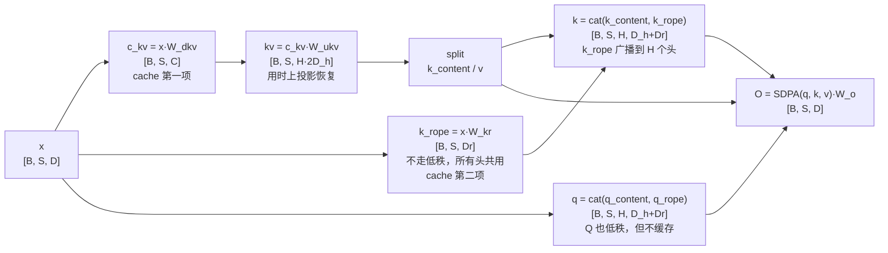

# 多头潜在注意力 (Multi-Latent Attention, MLA)

> KV 低秩压缩到潜空间，DeepSeek-V2 核心

## 📌 原理与思想

### 核心概念
将 KV 先下投影压缩到低维潜空间（存入 Cache），再上投影恢复。压缩比可达 90%+，远超 GQA 的 75%。相比 GQA，MLA 通过低秩压缩实现更极致的 KV Cache 压缩，是 DeepSeek-V2 的核心创新。

### 核心思想
利用低秩矩阵分解压缩 KV：先下投影到 latent_dim（存入 Cache），再上投影恢复 k 的内容部分与 v。位置分量 k_rope 不走这条路 —— 它直接从 x 投出来（所有头共用一份），因为 RoPE 是位置相关的，挤进低秩空间会被压坏；这一项同样要进 Cache，所以每 token 的缓存是 C + D_r 而不是 C。Q 也使用低秩投影，但不缓存（只用于当前 token）。RoPE 只应用于 k_rope 和 q_rope 部分。

### 算法步骤
1. KV 下投影压缩：c_kv = W_down(x) → [B, S, latent_dim]，进 Cache
2. 位置分量单独投，不走低秩：k_rope = W_kr(x) → [B, S, Dr]，所有头共用，也进 Cache
3. KV 上投影恢复：k_content, v = W_up(c_kv) → split
4. Q 下投影压缩：c_q = W_down_q(x)
5. Q 上投影恢复：q = W_up_q(c_q) → split → q_content, q_rope
6. 应用 RoPE：q_rope, k_rope = rope(q_rope, k_rope)
7. 合并内容：q = cat(q_content, q_rope), k = cat(k_content, broadcast(k_rope))
8. 计算注意力并输出投影

## 📐 核心公式

```math
c^{KV}=x\,W^{DKV}\in\mathbb{R}^{B\times S\times C},\qquad
[k_{\text{content}};v]=\text{split}\!\left(c^{KV}W^{UK}\right)
```

```math
k_{\text{rope}}=\text{RoPE}\!\left(x\,W^{KR}\right),\qquad
W^{KR}\in\mathbb{R}^{d\times D_r}
```

```math
c^{Q}=x\,W^{DQ},\qquad
Q=\text{split}\!\left(c^{Q}W^{UQ}\right)
```

```math
k=[k_{\text{content}};k_{\text{rope}}],\qquad q=[q_{\text{content}};q_{\text{rope}}]
```

```math
\begin{aligned}
\text{GQA}: &\quad \text{KV cache}=2\,G\,D_h\\[2pt]
\text{MLA}: &\quad \text{KV cache}=C+D_r\qquad (C=512,\ D_r=64)
\end{aligned}
```

## 📊 张量流程图



## 💻 代码实现

```python
import torch
import torch.nn as nn
import torch.nn.functional as F
import math

class MLA(nn.Module):
    def __init__(self, d_model, n_heads, dh, latent_dim, rope_dim, max_len=2048):
        super().__init__()
        self.h, self.dh, self.dr = n_heads, dh, rope_dim
        
        self.kv_down = nn.Linear(d_model, latent_dim, bias=False)
        self.kv_up = nn.Linear(latent_dim, n_heads*2*dh, bias=False)
        self.k_rope_proj = nn.Linear(d_model, rope_dim, bias=False)
        
        self.q_down = nn.Linear(d_model, latent_dim, bias=False)
        self.q_up = nn.Linear(latent_dim, n_heads*(dh+rope_dim), bias=False)
        
        self.wo = nn.Linear(n_heads*dh, d_model, bias=False)
        self.rope = RotaryEmbedding(rope_dim, max_len)   # 见「RoPE」一题

    def forward(self, x, mask=None):
        B, S, _ = x.shape
        
        c_kv = self.kv_down(x)
        k_r = self.k_rope_proj(x).view(B, S, 1, self.dr)
        
        k_c, v = self.kv_up(c_kv).view(B, S, self.h, -1).split([self.dh, self.dh], dim=-1)
        
        q = self.q_up(self.q_down(x)).view(B, S, self.h, -1)
        q_c, q_r = q.split([self.dh, self.dr], dim=-1)
        
        q_r, k_r = self.rope(q_r, k_r)
        
        k_r = k_r.expand(B, S, self.h, self.dr)
        q = torch.cat([q_c, q_r], dim=-1).transpose(1, 2)
        k = torch.cat([k_c, k_r], dim=-1).transpose(1, 2)
        v = v.transpose(1, 2)
        
        scores = torch.matmul(q, k.transpose(-2, -1)) / math.sqrt(self.dh+self.dr)
        if mask is not None:
            scores = scores.masked_fill(mask==0, float('-inf'))
        out = torch.matmul(F.softmax(scores, dim=-1), v)
        out = out.transpose(1, 2).contiguous().view(B, S, -1)
        return self.wo(out)

# 测试
if __name__ == "__main__":
    B, S, D = 2, 10, 512
    x = torch.randn(B, S, D)
    mla = MLA(D, n_heads=8, dh=64, latent_dim=128, rope_dim=32)
    out = mla(x)
    print(f"Input shape: {x.shape}")
    print(f"Output shape: {out.shape}")
    print(f"每 token cache: {mla.kv_down.out_features + mla.k_rope_proj.out_features} 维"
          f"  (GQA/G=2 要 {2*2*mla.dh} 维, MHA 要 {2*mla.h*mla.dh} 维)")
```

## 🎯 面试要点

- **KV 先压缩到 latent_dim 再恢复**，Cache 只存压缩后向量
- **压缩比可达 90%+** (vs GQA 75%)
- **Q 也使用低秩投影**，但不缓存（只用于当前 token）
- **DeepSeek-V2 用 MLA + MoE** 实现极高效率
- **面试重点**: 理解低秩压缩的思想，不要求完整实现
- **压缩发生的位置**: 进 cache 的只有 c_kv（C）和 k_rope（D_r）—— 压缩的是存储维度，不是头数（这是与 GQA 的本质区别）
- **RoPE 必须单独走不压缩的分量**: 它是位置相关的，挤进低秩空间会被压坏；代价就是每 token 的 cache 是 C + D_r（DeepSeek-V2 为 512 + 64），不是 C

