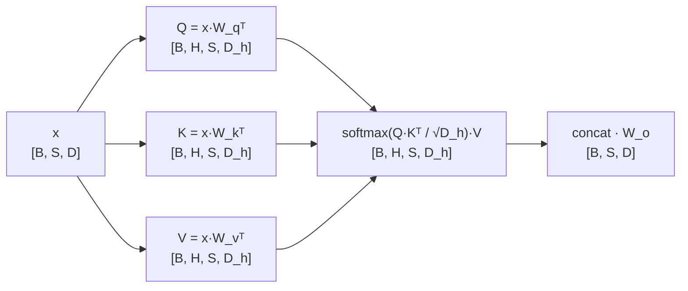

# 多头注意力 (Multi-Head Attention)

> 并行多头 → 拼接 → 输出投影

## 📌 原理与思想

### 核心概念
将输入投影到多个子空间，每个头独立计算注意力，最后拼接并通过线性层融合。相比单头注意力，多头机制允许模型同时关注不同位置的不同表示子空间，捕捉更丰富的语义关系。

### 核心思想
通过多个独立的注意力头，每个头学习不同的注意力模式（如语法关系、语义关系等）。最后通过输出投影融合所有头的信息，增强模型的表达能力。

中间那个注意力矩阵是 [B, H, S, S]，显存与头数成正比 —— 这正是 GQA、MQA 要砍掉的那一项；而输出投影 W_o 是唯一发生跨头交互的地方。

### 算法步骤
1. 线性投影：Q = x @ Wq, K = x @ Wk, V = x @ Wv
2. 分头：view(B, S, H, Dh).transpose(1, 2) → [B, H, S, Dh]
3. 对每个头计算缩放点积注意力
4. 合并多头：transpose(1, 2).contiguous().view(B, S, D)
5. 输出投影：output = concat_output @ Wo

## 📐 核心公式

```math
\text{MultiHead}(Q,K,V)=\text{Concat}\!\left(\text{head}_1,\dots,\text{head}_H\right)W_O
```

```math
\text{head}_i=\text{Attention}\!\left(QW_i^{Q},\ KW_i^{K},\ VW_i^{V}\right),
\qquad
D_h=\frac{D}{H}
```

## 📊 张量流程图



## 💻 代码实现

```python
import torch
import torch.nn as nn
import torch.nn.functional as F
import math

class MultiHeadAttention(nn.Module):
    def __init__(self, d_model, n_heads):
        super().__init__()
        assert d_model % n_heads == 0
        self.h, self.dh = n_heads, d_model // n_heads
        
        self.wq = nn.Linear(d_model, d_model)
        self.wk = nn.Linear(d_model, d_model)
        self.wv = nn.Linear(d_model, d_model)
        self.wo = nn.Linear(d_model, d_model)

    def forward(self, xq, xk=None, mask=None):
        """
        xq: [batch, seq_len_q, d_model]
        xk: [batch, seq_len_k, d_model] (None for self-attention)
        mask: [batch, 1, seq_len_q, seq_len_k]
        """
        B = xq.size(0)
        xk = xk if xk is not None else xq  # self-attention
        
        # 线性投影
        q = self.wq(xq).view(B, -1, self.h, self.dh).transpose(1, 2)
        k = self.wk(xk).view(B, -1, self.h, self.dh).transpose(1, 2)
        v = self.wv(xk).view(B, -1, self.h, self.dh).transpose(1, 2)
        
        # 缩放点积注意力
        scores = torch.matmul(q, k.transpose(-2, -1)) / math.sqrt(self.dh)
        if mask is not None:
            scores = scores.masked_fill(mask == 0, -1e9)
        attn = F.softmax(scores, dim=-1)
        
        # 加权求和
        out = torch.matmul(attn, v)  # [B, H, S, Dh]
        
        # 合并多头
        out = out.transpose(1, 2).contiguous().view(B, -1, self.h * self.dh)
        return self.wo(out)

# 测试
if __name__ == "__main__":
    B, S, D, H = 2, 10, 64, 8
    x = torch.randn(B, S, D)
    mha = MultiHeadAttention(D, H)
    
    # self-attention 写成 mha(x) 就够了：xk 省略时 forward 会兜底成 xq。
    # 传 mha(x, x) 是把同一份输入传两遍，走的是交叉注意力那条分支，
    # 「xk 为 None」这个兜底反而没被覆盖到 —— 两条分支等价，顺手比一下
    out = mha(x)
    print(f"Input shape: {x.shape}")   # [2, 10, 64]
    print(f"Output shape: {out.shape}") # [2, 10, 64]
    print("xk=None 与 xk=x 等价:", torch.allclose(out, mha(x, x)))
    
    # xk 存在的意义是交叉注意力（解码器的 Q 看编码器的 K/V），两条序列长度可以不同
    enc = torch.randn(B, 6, D)
    print(f"交叉注意力输出 (S_q=10, S_k=6): {mha(x, enc).shape}")  # [2, 10, 64]
    
    # mask 的形状是 [B, 1, S_q, S_k]，不是 [S, S]：位置 0 在因果掩码下只剩自己一个
    # 可看的位置，输出应当正好等于对 V_0 做输出投影
    causal = torch.tril(torch.ones(S, S)).view(1, 1, S, S)
    masked = mha(x, mask=causal)
    print("掩码后位置 0 = W_o·V_0:",
          torch.allclose(masked[:, 0], mha.wo(mha.wv(x)[:, 0]), atol=1e-6))
```

## 🎯 面试要点

- **分头操作**: `view(B,S,H,Dh).transpose(1,2)` — 面试必写
- **合并操作**: `transpose(1,2).contiguous().view(B,S,D)`
- **自注意力**: Q=K=V=x
- **交叉注意力**: Q=x_dec, K=V=x_enc
- **head_dim = d_model / n_heads**，通常 64 或 128
- **参数量**: 与单头完全相同，4 × d_model² (Wq, Wk, Wv, Wo)，只多出一组中间张量（H·Dh = D）


