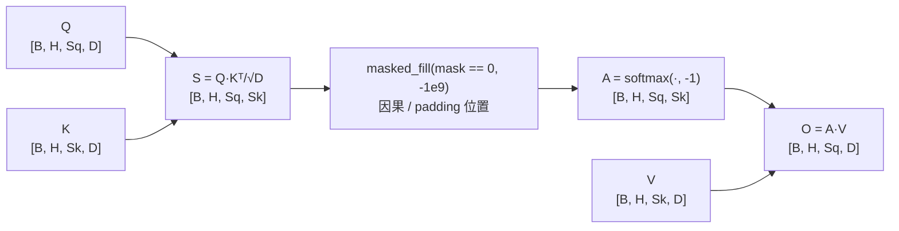

# 缩放点积注意力 (Scaled Dot-Product Attention)

> `softmax(QKᵀ/√d)V` — 所有注意力的基础

## 📌 原理与思想

### 核心概念
计算 Q 和 K 的点积，除以缩放因子 √d_k 后通过 softmax 得到注意力权重，最后加权求和 V。缩放防止点积过大导致梯度消失，是所有注意力变体（MHA/GQA/Flash Attention）的基础。

### 核心思想
通过点积衡量 Q 和 K 的相似度，softmax 归一化后作为权重对 V 加权求和。缩放因子 1/√d_k 确保方差稳定，使 softmax 不会进入饱和区。

### 算法步骤
1. 计算 Q 和 K 的点积：scores = Q @ K^T
2. 缩放：scores = scores / √d_k
3. 应用 mask（可选）：masked_fill(mask == 0, -inf)
4. Softmax 归一化：attn_weights = softmax(scores)
5. 加权求和：output = attn_weights @ V

## 📐 核心公式

```math
\text{Attention}(Q,K,V)=\text{softmax}\!\left(\frac{QK^{\top}}{\sqrt{d_k}}\right)V
```

```math
\text{softmax}(z)_i=\frac{e^{z_i}}{\sum_j e^{z_j}},\qquad
\text{Var}(q\cdot k)=d_k,\qquad
Q,K,V\in\mathbb{R}^{n\times d_k},\qquad
d_k=\frac{D}{H}
```

## 📊 张量流程图



## 💻 代码实现

```python
import torch
import torch.nn.functional as F
import math

def scaled_dot_product_attention(q, k, v, mask=None):
    """缩放点积注意力；q, k, v: [batch, num_heads, seq_len, head_dim]；mask: [batch, 1, seq_len_q, seq_len_k] (0=屏蔽)"""
    d_k = q.size(-1)
    
    scores = torch.matmul(q, k.transpose(-2, -1)) / math.sqrt(d_k)
    
    if mask is not None:
        scores = scores.masked_fill(mask == 0, -1e9)
    
    attn_weights = F.softmax(scores, dim=-1)
    
    output = torch.matmul(attn_weights, v)
    
    return output, attn_weights

# 测试
if __name__ == "__main__":
    B, H, S, D = 2, 4, 8, 64
    q = torch.randn(B, H, S, D)
    k = torch.randn(B, H, S, D)
    v = torch.randn(B, H, S, D)
    
    causal_mask = torch.tril(torch.ones(S, S)).view(1, 1, S, S)
    
    output, weights = scaled_dot_product_attention(q, k, v, mask=causal_mask)
    print(f"Output shape: {output.shape}")
    print(f"Weights shape: {weights.shape}")
```

## 🎯 面试要点

- **缩放因子 1/√d_k**: 当 d_k 大时点积方差大，softmax 进入饱和区梯度消失
- **mask=0 位置填 -1e9**: softmax 后≈0，实现因果/填充屏蔽
- **这是 MHA / GQA / MQA / Flash Attention 的公共基础**
- **时间复杂度**: O(n²d)，空间复杂度 O(n²)
- **面试常问**: 为什么要缩放？不缩放会怎样？


