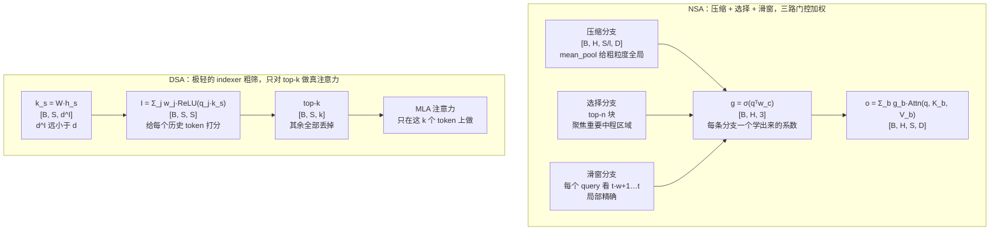

# 稀疏注意力 (Native Sparse Attention / DeepSeek Sparse Attention)

> 长上下文下 O(S²) 不可行：压缩 + 选择 + 滑窗，或索引器 + top-k

## 📌 原理与思想

### 核心概念
长上下文注意力是 `O(S²)`，必须稀疏化。NSA 走三分支路线：压缩块注意力（粗粒度全局）、top-n 块选择（中粒度重要区域）、滑动窗口（局部精确），再用学到的门控加权求和；DSA 走另一条路，用一个极轻的 lightning indexer 给每个历史 token 打分，只对 top-k 个 token 做真正的注意力。两者都把复杂度降到 `O(S·n)` 或 `O(S·k)`，也都要求块对齐以适配硬件 —— 代价是块大小 `l` 成了超参，太小则选择本身变贵，太大则选得不够精细。

### 核心思想
注意力权重实际上是稀疏的 —— 绝大多数位置对当前 token 无关，稠密计算在浪费算力。难点在「怎么稀疏」：套固定模式（只看滑窗）会丢掉长程依赖，随机或启发式选择非连续，gather 会让 GPU 利用率崩掉。所以能用的方案必须同时满足三条：保住长程信息、选择是学出来的、粒度块对齐。

### 算法步骤
1. NSA：先把 `K/V` 按块均值池化成 `K_cmp`（块大小 `l`），用压缩后的表示做一次粗粒度注意力。
2. 同一份 `K_cmp` 的分数用来挑 top-n 个块，再取回这些块的**原始** `KV` 做精注意力；同时保留最近 `w` 个 token 的滑窗。
3. 三路输出按 `g = σ(qᵀw_c)` 加权求和，每个头、每条分支各有一个可学的 `w_c`，门控是学出来的，模型自己决定何时依赖全局、何时只看局部。
4. DSA：`k_s = W^{K,l}·h_s` 是一个很轻的 key 投影（`d^I` 远小于 `d`），`I_{t,s} = Σ_j w_{t,j}·ReLU(q_{t,j}·k_s)` 给每个历史 token 打分，取 top-k 后再在这 `k` 个 token 上做 MLA 注意力。
5. Indexer 维度极低且能用 FP8 跑，所以「给所有历史 token 打分」这一步的代价可以忽略。

## 📐 核心公式

```math
\begin{aligned}
K_{\text{cmp},j} &= \text{mean}\!\left(K_{jl:(j+1)l}\right)\\[2pt]
p_j &= \text{score}\!\left(q_t,K_{\text{cmp},j}\right),\qquad
\mathcal{B}_{\text{slc}}=\text{top}_{n}(p)\\[2pt]
\mathcal{B}_{\text{win}} &= \{t-w,\dots,t\}
\end{aligned}
```

```math
o_t=\sum_{b\in\{\text{cmp},\text{slc},\text{win}\}} g_b\,\text{Attn}(q_t,K_b,V_b),
\qquad
g=\sigma\!\left(w^{\top}[q_t;\dots]\right)
```

```math
k_s=W^{K,l}h_s,\qquad
I_{t,s}=\sum_j w_{t,j}\text{ReLU}(q_{t,j}\cdot k_s),\qquad
\mathcal{S}_t=\text{top}_{k}\!\left(I_{t,\cdot}\right)
```

```math
\mathcal{S}_t\subseteq\{s\le t\},\qquad k=2048,\qquad O(S^{2})\to O(S\,k)
```

## 📊 张量流程图



## 💻 代码实现

```python
import torch
import torch.nn as nn
import torch.nn.functional as F
import math


def compress_blocks(x, block_size):
    """块内均值池化: [B,H,S,D] → [B,H,S//l,D]"""
    B, H, S, D = x.shape
    n_blocks = S // block_size
    x = x[:, :, :n_blocks * block_size].reshape(B, H, n_blocks, block_size, D)
    return x.mean(dim=3)                                   # [B, H, n_blocks, D]


def sdpa(q, k, v, scale):
    """标准缩放点积注意力（q 可以是多一个维度的 query 维）"""
    return F.softmax(q @ k.transpose(-1, -2) * scale, dim=-1) @ v


def causal_window_index(seq_len, window, device='cpu'):
    """滑窗的 key 下标：query t 对应 k[t-w+1 … t]，返回 (下标 [S, w], 有效位 [S, w])

    左侧越界的位置下标补成 0，再靠有效位掩掉 —— 补 0 是为了能一次性 gather 出
    整张 [S, w] 的表，而不是退回逐 query 的循环。"""
    offset = torch.arange(window, device=device) - (window - 1)      # [-(w-1), …, 0]
    key_idx = torch.arange(seq_len, device=device)[:, None] + offset[None, :]
    return key_idx.clamp_min(0), key_idx >= 0


def nsa_attention(q, k, v, gate_w, block_size=8, top_n=2, window=16):
    """
    NSA 三分支稀疏注意力
    q, k, v: [B, H, S, D]；返回 o: [B, H, S, D]
    gate_w:  [H, D, 3] 可学习的门控向量（每个头、每个分支一个），模型里是 nn.Parameter
    注意: 这里只补齐了窗口支的因果性；压缩、选择两支仍省略了块级因果掩码 ——
    真实实现还要按块排除未来块、并对选中的块做 token 级掩码
    """
    B, H, S, D = q.shape
    scale = 1.0 / math.sqrt(D)
    n_blocks = S // block_size

    # ---------- 分支 1: 压缩块注意力（粗粒度全局）----------
    o_cmp = sdpa(q, compress_blocks(k, block_size), compress_blocks(v, block_size), scale)

    # ---------- 分支 2: top-n 块选择（中粒度重要区域）----------
    k_cmp = compress_blocks(k, block_size)                 # 用压缩表示来粗选
    scores = q @ k_cmp.transpose(-1, -2) * scale           # [B, H, S, n_blocks]
    top_idx = scores.topk(min(top_n, n_blocks), dim=-1).indices        # [B,H,S,top_n]

    # 把 K/V 重排成块，再按选中的块索引取回（块对齐，硬件友好）
    k_blk = k[:, :, :n_blocks * block_size].reshape(B, H, n_blocks, block_size, D)
    v_blk = v[:, :, :n_blocks * block_size].reshape(B, H, n_blocks, block_size, D)
    bidx = torch.arange(B, device=q.device).view(B, 1, 1, 1)
    hidx = torch.arange(H, device=q.device).view(1, H, 1, 1)
    k_sel = k_blk[bidx, hidx, top_idx]                     # [B,H,S,top_n,l,D]
    v_sel = v_blk[bidx, hidx, top_idx]
    k_sel = k_sel.reshape(B, H, S, -1, D)                  # [B,H,S,top_n*l,D]
    v_sel = v_sel.reshape(B, H, S, -1, D)
    o_slc = sdpa(q.unsqueeze(3), k_sel, v_sel, scale).squeeze(3)

    # ---------- 分支 3: 滑动窗口（局部精确）----------
    # 窗口是「每个 query 自己往前 w 个 token」：query t 只看 k[t-w+1 … t]。
    # 注意别写成 k[:, :, -win:, :] —— 那是给所有 query 都切全局最后 w 个，
    # 第 0 个 query 会看到第 16 个 token：既不是滑窗，也不再因果
    win = min(window, S)
    key_idx, win_valid = causal_window_index(S, win, q.device)
    k_win, v_win = k[:, :, key_idx], v[:, :, key_idx]        # [B, H, S, win, D]
    win_scores = (q.unsqueeze(3) @ k_win.transpose(-1, -2)) * scale   # [B,H,S,1,win]
    win_scores = win_scores.masked_fill(~win_valid.view(1, 1, S, 1, win), float('-inf'))
    o_win = (F.softmax(win_scores, dim=-1) @ v_win.unsqueeze(3)).squeeze(3)

    # ---------- 门控加权求和 ----------
    # 门控必须学出来：三条分支的相对重要性随层数、位置、任务变化，硬相加不行。
    # g = σ(qᵀw_c)，每个头、每条分支各有一个可学的 w_c，三个系数互相独立 ——
    # 若三条分支拿到同一个系数，「加权」就退化成了对所有分支乘同一个数
    g = torch.sigmoid(torch.einsum("bhsd,hdc->bhsc", q, gate_w))      # [B, H, S, 3]
    w_cmp, w_slc, w_win = g[..., 0], g[..., 1], g[..., 2]             # 各 [B, H, S]
    return (w_cmp.unsqueeze(-1) * o_cmp
            + w_slc.unsqueeze(-1) * o_slc
            + w_win.unsqueeze(-1) * o_win)


class LightningIndexer(nn.Module):
    """DSA 的 lightning indexer: 轻量投影 + ReLU 打分 + top-k"""

    def __init__(self, n_heads, d_model, d_index=16):
        super().__init__()
        self.wq = nn.Linear(d_model, n_heads * d_index, bias=False)
        self.wk = nn.Linear(d_model, d_index, bias=False)
        self.w_scale = nn.Linear(d_model, n_heads, bias=False)    # 每个 head 的标量权重
        self.n_heads, self.d_index = n_heads, d_index

    def forward(self, h, top_k=8):
        """h: [B, S, D] 隐状态；返回每个 query 选中的 token 索引 [B, S, top_k]"""
        B, S, _ = h.shape
        q = self.wq(h).view(B, S, self.n_heads, self.d_index).transpose(1, 2)  # [B,H,S,d]
        k = self.wk(h)                                                        # [B,S,d]
        w = self.w_scale(h).transpose(1, 2)                                   # [B,H,S]

        # 每个 indexer head 打分后 ReLU（可跑 FP8），再用标量权重加权求和
        dot = q @ k.transpose(-1, -2)                                         # [B,H,S,S]
        score = (w.unsqueeze(-1) * torch.relu(dot)).sum(dim=1)                              # [B,S,S]

        # 因果: 只看过去
        causal = torch.tril(torch.ones(S, S, dtype=torch.bool, device=h.device))
        score = score.masked_fill(~causal, float("-inf"))
        return score.topk(min(top_k, S), dim=-1).indices                      # [B,S,top_k]


if __name__ == "__main__":
    torch.manual_seed(0)
    B, H, S, D = 1, 4, 64, 16
    q, k, v = (torch.randn(B, H, S, D) for _ in range(3))

    o = nsa_attention(q, k, v, gate_w=torch.randn(H, D, 3), block_size=8, top_n=2, window=16)
    print("NSA 输出:", tuple(o.shape), "(与输入同形)")

    # 窗口支验一眼语义：每个 query 的窗口右端必须正好落在自己身上（= 不看未来）。
    # 原来那版是给所有 query 切全局最后 w 个 key，这条根本不成立
    key_idx, valid = causal_window_index(S, window=16)
    print("query 0 的窗口下标:", key_idx[0].tolist())
    print("窗口右端都等于自身位置:",
          bool((key_idx.max(dim=1).values == torch.arange(S)).all()))
    print("左侧越界的窗口位置:", int((~valid).sum()), "(补成下标 0 后被 -inf 掩掉)")

    indexer = LightningIndexer(H, D, d_index=16)
    idx = indexer(torch.randn(B, S, D), top_k=8)
    print("indexer 选中索引:", tuple(idx.shape))
    print("每个 query 只算 8 个 token → O(S·k) 而非 O(S²)")
```

## 🎯 面试要点

- **一句话**: 长上下文的注意力必须稀疏 —— NSA 靠三分支 + 门控，DSA 靠极轻的 indexer 选 top-k
- **三分支各解决什么**: 压缩块给粗粒度全局视野，top-n 选择聚焦重要中程区域，滑窗保证局部精确 —— 缺一个就有明显退化
- **为什么需要门控**: 三条分支的相对重要性随层数、位置、任务变化，硬相加不行，必须有可学习的权重
- **块级 vs token 级选择**: 块级选择（NSA）对硬件友好；DSA 的 token 级 top-k 靠极轻的 indexer 把选择成本压到可忽略
- **indexer 为什么能用 ReLU**: softmax 需要全序列归一化，ReLU 不需要，因此可以分块算、能跑 FP8 —— 这是「lightning」的工程前提
- **indexer 的维度要小**: `d^I` 刻意做得很小（几十维量级），选择成本才可以忽略
- **复杂度**: `O(S²)` → `O(S·k)`。`k=2048`、`S=128K` 时计算量约降两个数量级
- **训练不是一步到位**: DSA 先冻结主模型、只训 indexer 对齐分布（warm-up），再放开全部参数做稀疏训练
- **因果性**: 只能从当前 token 往前的历史里选，未来的块必须屏蔽
- **面试常问**: 稀疏注意力怎么保证不丢长程信息？为什么用块级别选择而不是 token 级别？