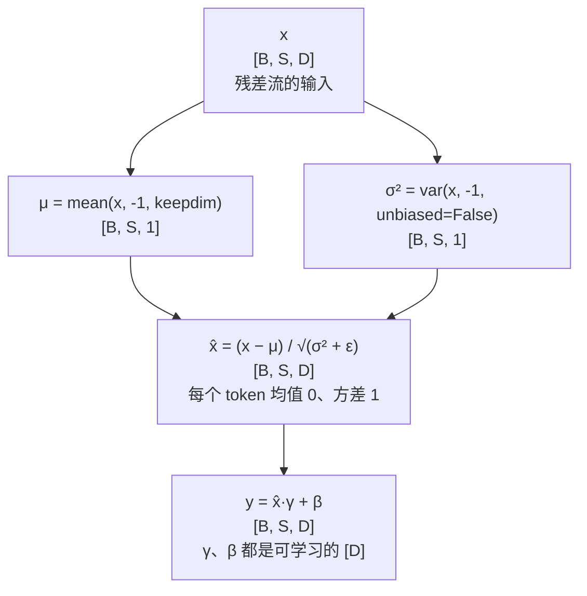

# 层归一化 (Layer Normalization)

> 沿特征维度归一化，Transformer 标配

## 📌 原理与思想

### 核心概念
在每个样本的特征维度上计算均值和方差进行归一化，再通过可学习的 gamma/beta 进行仿射变换。与 BatchNorm 不同，不依赖 batch size，适合序列模型，能稳定训练并加速收敛。

### 核心思想
沿特征维度归一化，使每个样本的特征分布稳定在均值为 0、方差为 1 附近。通过 gamma（缩放）和 beta（偏移）两个可学习参数，让模型自适应调整归一化后的分布。

### 算法步骤
1. 计算均值：μ = mean(x, dim=-1, keepdim=True)
2. 计算方差：σ² = var(x, dim=-1, keepdim=True, unbiased=False)
3. 归一化：x_norm = (x - μ) / √(σ² + ε)
4. 仿射变换：output = x_norm × γ + β

## 📐 核心公式

```math
\mu=\text{mean}(x,\ \dim=-1),\qquad
\sigma^{2}=\text{var}(x,\ \dim=-1,\ \text{unbiased}=\text{False})
```

```math
\text{LN}(x)=\frac{x-\mu}{\sqrt{\sigma^{2}+\epsilon}}\odot\gamma+\beta,
\qquad
\gamma,\beta\in\mathbb{R}^{D},\qquad
\epsilon=10^{-5}
```

## 📊 张量流程图



## 💻 代码实现

```python
import torch
import torch.nn as nn

class LayerNorm(nn.Module):
    def __init__(self, d_model, eps=1e-5):
        super().__init__()
        self.eps = eps
        self.gamma = nn.Parameter(torch.ones(d_model))
        self.beta = nn.Parameter(torch.zeros(d_model))

    def forward(self, x):
        """x: [B, S, D]"""
        mean = x.mean(-1, keepdim=True)
        
        var = x.var(-1, keepdim=True, unbiased=False)
        
        x_norm = (x - mean) / torch.sqrt(var + self.eps)
        return x_norm * self.gamma + self.beta

# 测试
if __name__ == "__main__":
    B, S, D = 2, 10, 64
    torch.manual_seed(0)
    x = torch.randn(B, S, D)
    ln = LayerNorm(D)
    out = ln(x)
    print(f"Input shape: {x.shape}")
    print(f"Output shape: {out.shape}")
    
    print(f"Mean: {out[0, 0].mean().item():.6f}")
    print(f"Var: {out[0, 0].var().item():.6f}")
    
    ref = torch.nn.LayerNorm(D, eps=1e-5)
    with torch.no_grad():
        ref.weight.copy_(ln.gamma)
        ref.bias.copy_(ln.beta)
    print("与 nn.LayerNorm 的最大误差 (应为 0):",
          (out - ref(x)).abs().max().item())
    
    wrong = (x - x.mean(-1, keepdim=True)) / torch.sqrt(
        x.var(-1, keepdim=True, unbiased=True) + 1e-5)
    print("方差改成 unbiased=True 后的差异:",
          (out - (wrong * ln.gamma + ln.beta)).abs().max().item())
```

## 🎯 面试要点

- **面试陷阱**: `torch.var` 默认 `unbiased=True` (N-1)，LN 要用 `False` (N)
- **gamma(缩放) 和 beta(偏移)** 两个可学习参数
- **Pre-Norm**: `x = x + SubLayer(LN(x))` — 现代 LLM 标配
- **Post-Norm**: `x = LN(x + SubLayer(x))` — 原始 Transformer
- **对比 BatchNorm**: BN 沿 batch 维度归一化，LN 沿特征维度
- **与 batch 无关**: 统计量取自每个 token 自己的 D 维；训练与推理走同一条路径，不像 BatchNorm 要维护滑动平均

