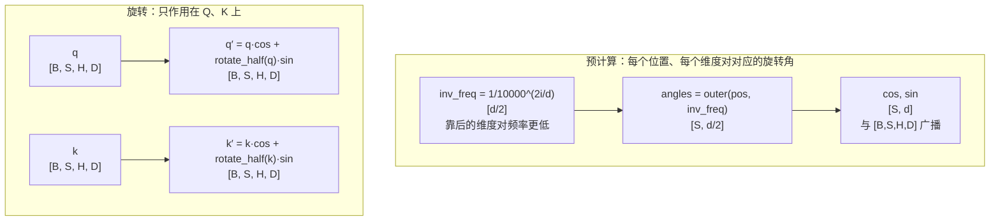

# 旋转位置编码 (Rotary Position Embedding, RoPE)

> 旋转 Q/K 向量注入位置信息，LLaMA 标配

## 📌 原理与思想

### 核心概念
将位置信息编码为旋转角度，对 Q 和 K 的 head 维度成对施加旋转：实现按前半区与后半区配对，即 (第 i 维, 第 i+d/2 维) 共用同一个角度。旋转后 Q·K 的点积自然包含相对位置信息。相比绝对位置编码（无法处理变长序列）和 ALiBi（需要额外参数），RoPE 无需额外参数即可自然编码相对位置。

### 核心思想
通过旋转矩阵将位置信息注入 Q 和 K。实现用的是 half-split 布局：把 head 维度劈成前后两半 x₁、x₂，第 i 组配对是 (x₁ 的第 i 维, x₂ 的第 i 维)，对每一对施加旋转 [-x₂, x₁]（单独看即旋转 90°）。原论文写的是相邻两维配对 (x₂ᵢ, x₂ᵢ₊₁)，与 half-split 只差一个维度排列、数学等价 —— 但两种布局混用会静默算错。旋转后 q_m · k_n 只依赖 m-n，天然具有相对位置感知能力。只对 Q 和 K 施加旋转，V 不变。

### 算法步骤
1. 预计算频率：inv_freq = 1/(10000^(2i/d))
2. 计算角度：angles = outer(positions, inv_freq)
3. 预计算 cos/sin：cos = cos(angles), sin = sin(angles)
4. 定义 rotate_half：chunk(x, 2, dim=-1) 劈成前后两半 → cat(-x2, x1)（配对是 (i, i+d/2)，不是相邻两维）
5. 应用旋转：q_rot = q × cos + rotate_half(q) × sin
6. 对 k 同样应用旋转

## 📐 核心公式

```math
f(q,m)=q\odot\cos(m\theta)+\text{rotate\_half}(q)\odot\sin(m\theta)
```

```math
\text{rotate\_half}\!\left(\left[x_1;x_2\right]\right)=\left[-x_2;x_1\right],\quad x_1,x_2\in\mathbb{R}^{d/2},
\qquad
R(m\theta)=\begin{pmatrix}\cos m\theta & -\sin m\theta\\[2pt] \sin m\theta & \cos m\theta\end{pmatrix}
```

```math
(R_mq)\cdot(R_nk)=q^{\top}R_{n-m}\,k
```

```math
\theta_i=10000^{-2i/d},\qquad i=0,\dots,\frac{d}{2}-1
```

## 📊 张量流程图



## 💻 代码实现

```python
import torch
import torch.nn as nn

class RotaryEmbedding(nn.Module):
    def __init__(self, head_dim, max_seq_len=2048, theta=10000.0):
        super().__init__()
        inv_freq = 1.0 / (theta ** (torch.arange(0, head_dim, 2).float() / head_dim))
        t = torch.arange(max_seq_len).float()
        angles = torch.outer(t, inv_freq)
        angles = torch.cat([angles, angles], dim=-1)
        self.register_buffer('cos', angles.cos())
        self.register_buffer('sin', angles.sin())

    def forward(self, q, k, start_pos=0):
        """q,k: [B, S, H, D]"""
        S = q.size(1)
        cos = self.cos[start_pos:start_pos + S].view(1, S, 1, -1)
        sin = self.sin[start_pos:start_pos + S].view(1, S, 1, -1)

        def rotate_half(x):
            x1, x2 = x.chunk(2, dim=-1)
            return torch.cat([-x2, x1], dim=-1)

        q_rot = q * cos + rotate_half(q) * sin
        k_rot = k * cos + rotate_half(k) * sin
        return q_rot, k_rot

# 测试
if __name__ == "__main__":
    B, S, H, D = 2, 10, 8, 64
    torch.manual_seed(0)
    q = torch.randn(B, S, H, D)
    k = torch.randn(B, S, H, D)
    
    rope = RotaryEmbedding(D)
    q_rot, k_rot = rope(q, k)
    
    print(f"Input q shape: {q.shape}")
    print(f"Output q shape: {q_rot.shape}")
    
    q5, k5 = rope(q[:, 5:6], k[:, 5:6], start_pos=5)
    print(f"增量解码位置对齐误差 (should be 0): {(q_rot[:, 5:6] - q5).abs().max().item():.6f}")
    
    base_q, base_k = q[0, 0], k[0, 0]
    qs, ks = rope(base_q[None].expand(1, S, -1, -1),
                  base_k[None].expand(1, S, -1, -1))
    norm = (base_q * base_k).sum().item()
    print(f"未旋转的 q·k: {norm:.6f}")
    for diff in (0, 3, -2):
        dots = [float((qs[0, m] * ks[0, m + diff]).sum())
                for m in range(S) if 0 <= m + diff < S]
        print(f"n-m={diff:+d}: {len(dots)} 组点积极差 {max(dots) - min(dots):.2e} "
              f"(值 {dots[0]:.6f})")
```

## 🎯 面试要点

- **rotate_half**: `chunk` 两半 → `cat(-x2, x1)` = 旋转 90°；配对是 (i, i+d/2)，按相邻两维写会算错
- **只对 Q 和 K 施加旋转**，V 不变
- **预计算 cos/sin** 避免重复计算
- **增量解码要传 start_pos**: 带 KV cache 每步只算 1 个 token，位置得从已缓存长度数起；写死 `[:S]` 会让每个新 token 都套上位置 0 的旋转角
- **天然具有相对位置感知**: q_m · k_n 只依赖 m-n
- **theta=10000 是标准值**，调整可实现长度外推 (NTK/YaRN)
- **LLaMA, Mistral, Qwen 等主流模型都使用 RoPE**


