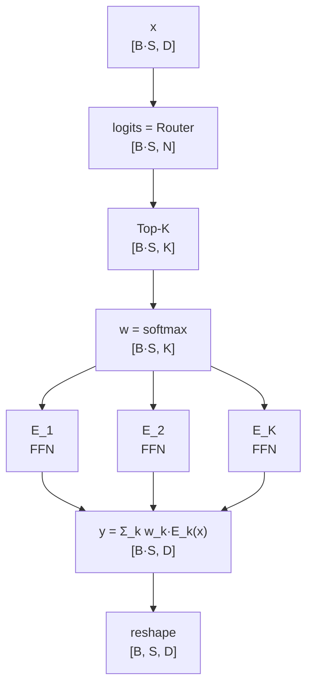

# 混合专家模型 (Mixture of Experts, MoE)

> 稀疏激活，大参数量小计算量

## 📌 原理与思想

### 核心概念
将 FFN 替换为多个"专家"网络，Router 为每个 token 选择 Top-K 个专家处理。总参数量大但每次只激活部分，计算量可控。相比 Dense 模型，MoE 可以增加模型容量但不增加计算量，如 Mixtral 8x7B 有 46.7B 参数但实际计算量仅约 12.9B。

### 核心思想
通过 Router 网络为每个 token 动态选择最相关的 K 个专家处理，实现稀疏激活。每个专家是独立的 FFN，只处理分配到的 token，最后加权融合。

总共有 N 份专家参数，而每个 token 只算 K 份，所以 FLOPs 只占 K/N —— 参数量与计算量解耦。

### 算法步骤
1. Router 计算：logits = Router(x)，得到每个专家的得分
2. Top-K 选择：选出得分最高的 K 个专家
3. 权重归一化：weights = softmax(top_k_logits)
4. 专家处理：每个 expert 处理分配到的 token
5. 加权融合：output = Σ(weights[i] × expert[i](x))
6. 负载均衡：训练时再加一项辅助损失 aux = N·Σ f_i·P_i，逼 Router 把 token 摊平（不加会塌到少数专家上）

## 📐 核心公式

```math
\text{MoE}(x)=\sum_{i\in\text{TopK}}w_i E_i(x),\qquad w_i=\frac{e^{z_i}}{\sum_{j\in\text{TopK}}e^{z_j}},\qquad z=\text{Router}(x)\in\mathbb{R}^{N}
```

```math
\text{Router}(x)=W_rx,\qquad W_r\in\mathbb{R}^{D\times N},\qquad K=2
```

```math
\mathcal{L}=\mathcal{L}_{\text{CE}}+\alpha\,\text{aux},\qquad
\text{aux}=N\sum_{i=1}^{N}f_iP_i,\qquad
f_i=\frac{1}{KT}\sum_{t}\mathbf{1}\!\left[i\in\text{TopK}(x_t)\right],\qquad
P_i=\frac{1}{T}\sum_{t}p_{t,i}
```

```math
\text{uniform}\ \Rightarrow\ f_i=P_i=\frac{1}{N}\ \Rightarrow\ \text{aux}=1
```

```math
\text{Mixtral 8x7B:}\quad N=8,\ K=2,\qquad \text{FLOPs}\approx 12.9\text{B}\ \text{vs}\ 46.7\text{B total}
```

## 📊 张量流程图



## 💻 代码实现

```python
import torch
import torch.nn as nn
import torch.nn.functional as F

class MoE(nn.Module):
    def __init__(self, d_model, n_experts, top_k):
        super().__init__()
        self.n_experts, self.top_k = n_experts, top_k
        self.router = nn.Linear(d_model, n_experts, bias=False)
        self.experts = nn.ModuleList([
            nn.Sequential(nn.Linear(d_model, 4*d_model), nn.SiLU(),
                          nn.Linear(4*d_model, d_model))
            for _ in range(n_experts)
        ])

    def forward(self, x):
        B, S, D = x.shape
        x_flat = x.view(-1, D)                        # [B*S, D]
        logits = self.router(x_flat)                   # [B*S, N]
        weights, indices = torch.topk(logits, self.top_k, dim=-1)
        weights = F.softmax(weights, dim=-1)           # 归一化

        output = torch.zeros_like(x_flat)
        for i, expert in enumerate(self.experts):
            mask = (indices == i)                       # 哪些 token 选了 expert i
            token_idx, topk_pos = torch.where(mask)
            if token_idx.numel() > 0:
                out = expert(x_flat[token_idx])
                output.index_add_(0, token_idx, out * weights[token_idx, topk_pos].unsqueeze(-1))
        return output.view(B, S, D)

    def aux_loss(self, x, coeff=0.01):
        """负载均衡辅助损失 N·Σ f_i·P_i（Switch Transformer），训练时加到总损失里

        不加这一项，Router 会很快塌到少数几个专家上：被选中的专家训得更好 →
        打分更高 → 更常被选中，最后大部分专家根本收不到 token。两项都在均匀时
        取最小值 1/N，乘起来再乘 N 正好是 1。

        f_i: 分给专家 i 的 token 占比（top-k 会把一个 token 记到 k 个专家上，
             所以除以 top_k，否则 f 之和是 k 而不是 1）
        P_i: Router 给专家 i 的平均概率 —— 注意要用「全部专家」的 softmax，
             forward 里那份是按 top-k 重新归一化过的，算 P 会用错分母
        """
        B, S, D = x.shape
        probs = F.softmax(self.router(x.view(-1, D)), dim=-1)          # [B*S, N]
        indices = torch.topk(probs, self.top_k, dim=-1).indices
        one_hot = F.one_hot(indices, self.n_experts).sum(dim=1).float()  # [B*S, N]
        f = one_hot.mean(dim=0) / self.top_k                           # [N]
        p = probs.mean(dim=0)                                          # [N]
        return coeff * self.n_experts * torch.sum(f * p)

# 测试
if __name__ == "__main__":
    torch.manual_seed(0)
    B, S, D = 2, 16, 512
    x = torch.randn(B, S, D)
    moe = MoE(D, n_experts=8, top_k=2)
    out = moe(x)
    print(f"Input shape: {x.shape}")   # [2, 16, 512]
    print(f"Output shape: {out.shape}") # [2, 16, 512]
    
    # 刚初始化的 Router 基本是均匀路由，这一项应取到最小值（coeff × 1）
    print(f"随机 Router 的 aux loss: {moe.aux_loss(x).item():.4f}  (均匀时 0.01)")
    
    # 极限情况：全正输入 + 只给专家 0 权重 → 专家 0 恒占优，所有 token 堆到一处，
    # 这一项应该涨到接近 N 倍 —— 这就是它「防塌缩」的作用
    skewed = MoE(D, n_experts=8, top_k=1)
    with torch.no_grad():
        skewed.router.weight.zero_()
        skewed.router.weight[0].fill_(1.0)          # logit_0 = Σx，全正输入下恒为最大
    x_pos = torch.randn(B, S, D).abs()
    bad = skewed.aux_loss(x_pos).item()
    print(f"全塌到专家 0 的 aux loss: {bad:.4f}  ({bad / 0.01:.1f} 倍)")
```

## 🎯 面试要点

- **Router 决定每个 token 由哪些专家处理**
- **Top-K 路由**: 每个 token 只激活 K 个专家
- **需要 load balancing loss** 防止专家负载不均
- **Mixtral 8x7B**: 8 专家选 2，计算量约 12.9B
- **DeepSeek-V2/V3**: MoE + MLA 实现极致效率
- **面试常问**: MoE 如何减少计算量？如何保证负载均衡？


