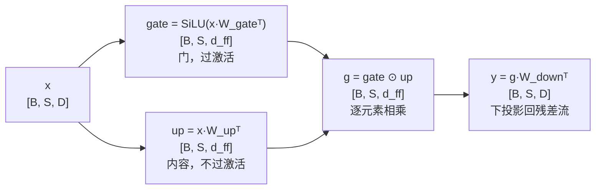

# SwiGLU

> 门控 + SiLU 激活，LLaMA/PaLM 标配

## 📌 原理与思想

### 核心概念
引入门控机制：一个分支用 SiLU 激活作为门，另一个分支无激活，两者逐元素相乘后下投影。相比标准 FFN+ReLU，门控机制让模型学习哪些信息通过，SiLU 激活更平滑，实验证明效果更好。LLaMA/PaLM/Mistral/Qwen 等主流模型都使用。

### 核心思想
通过门控机制控制信息流：Gate 分支用 SiLU 激活学习"哪些信息应该通过"，Up 分支无激活提供"信息内容"，两者逐元素相乘实现选择性传递。

### 算法步骤
1. 门控分支：gate = SiLU(W_gate · x)
2. 值分支：up = W_up · x
3. 门控相乘：activated = gate ⊙ up（逐元素乘法）
4. 下投影：output = W_down · activated

## 📐 核心公式

```math
\text{SwiGLU}(x)=W_{\text{down}}\!\left(\text{SiLU}(W_{\text{gate}}x)\odot W_{\text{up}}x\right)
```

```math
\text{SiLU}(x)=x\,\sigma(x),\qquad d_{ff}=\frac{8}{3}D
```

```math
\begin{aligned}
\text{SwiGLU}: &\quad 3D\,d_{ff}\approx 8D^{2}\\[2pt]
\text{FFN}: &\quad 8D^{2}
\end{aligned}
```

## 📊 张量流程图



## 💻 代码实现

```python
import torch
import torch.nn as nn
import torch.nn.functional as F

class SwiGLU(nn.Module):
    def __init__(self, d_model, d_ff=None):
        super().__init__()
        d_ff = d_ff or int(8/3 * d_model)  # 保持参数量与标准FFN相当
        self.w_gate = nn.Linear(d_model, d_ff, bias=False)
        self.w_up = nn.Linear(d_model, d_ff, bias=False)
        self.w_down = nn.Linear(d_ff, d_model, bias=False)

    def forward(self, x):
        """x: [B, S, D]"""
        gate = F.silu(self.w_gate(x))   # 门控分支
        up = self.w_up(x)               # 值分支
        return self.w_down(gate * up)    # 门控相乘 → 下投影

# 测试
if __name__ == "__main__":
    B, S, D = 2, 10, 512
    torch.manual_seed(0)
    x = torch.randn(B, S, D)
    swiglu = SwiGLU(D)
    out = swiglu(x)
    print(f"Input shape: {x.shape}")   # [2, 10, 512]
    print(f"Output shape: {out.shape}") # [2, 10, 512]
    
    # 注释里写了「d_ff = 8/3·d 是为了保持参数量与标准 FFN 相当」，
    # 但这笔账从没算过：SwiGLU 有三个矩阵、标准 FFN 只有两个，
    # 所以 d_ff 必须缩到 2/3 才能在参数上打平 —— 值得直接印出来对一遍
    ffn = FFN(D)                       # 见「FFN」一题
    count = lambda m: sum(p.numel() for p in m.parameters())
    print(f"参数量: SwiGLU {count(swiglu):,} vs FFN {count(ffn):,} "
          f"({count(swiglu) / count(ffn):.2%})")
```

## 🎯 面试要点

- **三个权重矩阵** (Gate/Up/Down)，标准 FFN 只有两个
- **SiLU(x) = x × sigmoid(x)**，也称 Swish
- **d_ff 通常取 8/3 × d_model**（保持总参数量相当）
- **LLaMA, PaLM, Mistral, Qwen 等主流模型都使用**
- **面试常问**: SwiGLU 和标准 FFN 的区别？为什么效果更好？


