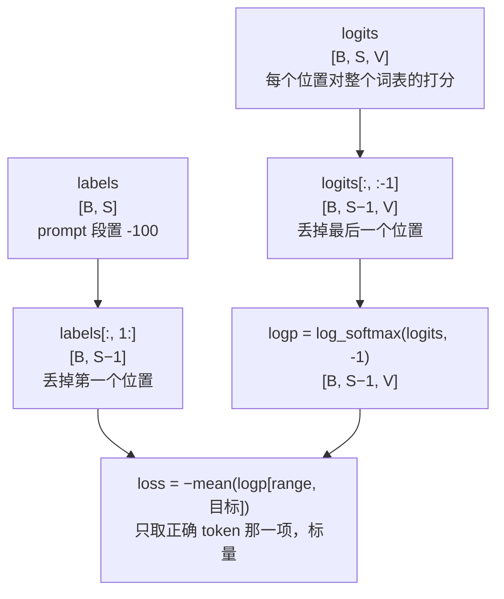

# 交叉熵 / 语言模型损失 (Cross Entropy / LM Loss)

> 下一个 token 预测，LLM 训练基础

## 📌 原理与思想

### 核心概念
语言模型的核心训练目标：给定前文预测下一个 token。通过 shift 操作将 logits 和 labels 对齐，计算交叉熵。交叉熵衡量预测分布与真实分布的差异，梯度计算简洁（softmax + CE 的梯度 = y - one_hot），是 LLM 训练的基础。

### 核心思想
用前面的 token 预测下一个 token。通过 shift 操作：logits 去尾（去掉最后一个位置的预测），labels 去头（去掉第一个位置的目标），使 logits[:, :-1] 预测 labels[:, 1:]。

### 算法步骤
1. Shift logits：shift_logits = logits[:, :-1, :]
2. Shift labels：shift_labels = labels[:, 1:]
3. 展平：flattened_logits = shift_logits.view(-1, V)
4. 展平：flattened_labels = shift_labels.view(-1)
5. 计算交叉熵：loss = CE(flattened_logits, flattened_labels)

## 📐 核心公式

```math
\mathcal{L}_{\text{CE}}=-\frac{1}{|x|}\sum_{t=1}^{|x|}\log P_\theta(x_t\mid x_{<t})
```

```math
\text{CE}\!\left(\text{shift}(\text{logits}),\ \text{shift}(\text{labels})\right),
\qquad
\text{logits}[:,:-1]\ \text{predicts}\ \text{labels}[:,1:]
```

```math
\begin{aligned}
\text{Pretrain}: &\quad \text{all tokens counted}\\[2pt]
\text{SFT}: &\quad \text{label}_{\text{prompt}}=-100,\qquad \text{ignore\_index}=-100
\end{aligned}
```

## 📊 张量流程图



## 💻 代码实现

```python
import torch
import torch.nn.functional as F

def lm_loss(logits, labels, ignore_index=-100):
    """语言模型损失（下一个 token 预测）；logits: [B, S, vocab_size]，labels: [B, S]"""
    shift_logits = logits[:, :-1, :].contiguous()
    shift_labels = labels[:, 1:].contiguous()
    
    return F.cross_entropy(
        shift_logits.view(-1, shift_logits.size(-1)),
        shift_labels.view(-1),
        ignore_index=ignore_index
    )

def sft_loss(logits, labels, prompt_lengths):
    """SFT 损失：prompt 部分设为 -100"""
    masked_labels = labels.clone()
    for i, plen in enumerate(prompt_lengths):
        masked_labels[i, :plen] = -100
    return lm_loss(logits, masked_labels)

# 测试
if __name__ == "__main__":
    import math
    torch.manual_seed(0)
    B, S, V = 2, 10, 32000
    logits = torch.randn(B, S, V)
    labels = torch.randint(0, V, (B, S))

    loss = lm_loss(logits, labels)
    print(f"Loss: {loss.item():.4f}  (随机 logits 会略高于 ln(V) = {math.log(V):.2f}，"
          f"多出来的是 logits 偏离均匀的 KL)")

    logp = F.log_softmax(logits[:, :-1], dim=-1).reshape(-1, V)
    tgt = labels[:, 1:].reshape(-1)
    manual = -logp[torch.arange(tgt.numel()), tgt].mean()
    print(f"手算 {manual.item():.4f} / 误差 {(loss - manual).abs().item():.2e}")

    peaked = F.one_hot(labels[:, 1:], V).float() * 50
    aligned = lm_loss(torch.cat([peaked, peaked[:, -1:]], dim=1), labels)
    mis = F.cross_entropy(peaked.reshape(-1, V), labels[:, :-1].reshape(-1))
    print(f"对齐正确 {aligned.item():.4f} / 错位一格 {mis.item():.4f}")

    bumped = logits.clone()
    bumped[:, -1] += 100.0
    print(f"改最后一个位置后 loss 的变化 (should be 0): "
          f"{(lm_loss(bumped, labels) - loss).abs().item():.2e}")

    prompt_lengths = [2, 5]
    sft = sft_loss(logits, labels, prompt_lengths)
    masked = labels.clone()
    for i, plen in enumerate(prompt_lengths):
        masked[i, :plen] = -100
    tgt_sft = masked[:, 1:].reshape(-1)
    picked = -logp[torch.arange(tgt_sft.numel()), tgt_sft.clamp_min(0)]
    keep = tgt_sft != -100
    print(f"SFT loss {sft.item():.4f} / 只对保留的 {int(keep.sum())}/{tgt_sft.numel()} 个位置"
          f"求均值 {picked[keep].mean().item():.4f} (整段是 {loss.item():.4f})")
    print(f"  若分母错写成整段长度: {(picked[keep].sum() / tgt_sft.numel()).item():.4f}"
          f" —— 少掉的 response token 会被稀释")
    print(f"prompt 全空时应与整段一致: {(sft_loss(logits, labels, [0, 0]) - loss).abs().item():.2e}")
```

## 🎯 面试要点

- **Shift 操作是核心**: logits 去尾，labels 去头
- **ignore_index=-100** 的位置不参与梯度
- **Pretrain**: 所有 token 参与 loss
- **SFT**: prompt 部分 label 设为 -100，只算 response
- **面试常问**: Pretrain Loss 和 SFT Loss 的区别？
- **梯度形式**: ∂L/∂logits = softmax(logits) − one_hot(目标)，预测越离谱梯度越大

