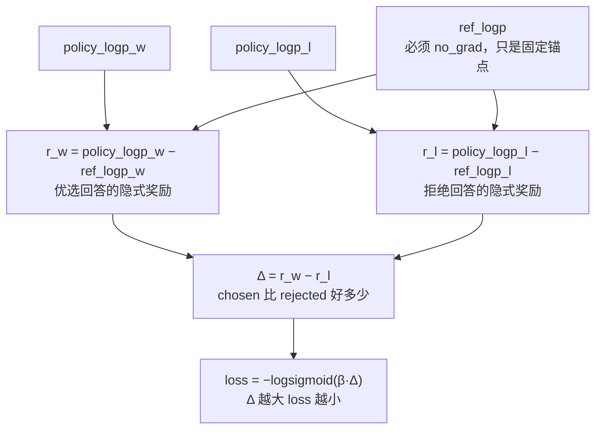

# DPO 损失 (Direct Preference Optimization)

> 无需奖励模型，直接优化偏好数据

## 📌 原理与思想

### 核心概念
将奖励函数参数化为策略与参考策略的对数比率，直接在偏好数据上优化。增加 chosen 概率，降低 rejected 概率。相比 PPO 不需要 reward model 和 critic，训练更简单稳定，效果相当甚至更好。

### 核心思想
利用 RL 的对偶性，将奖励函数隐式表示为 r(x,y) = β · log(πθ(y|x)/πref(y|x))。这样策略优化目标可以直接用策略的对数概率差来表示，无需显式奖励模型。

### 算法步骤
1. 收集偏好数据：(prompt, chosen_response, rejected_response)
2. 计算策略与参考策略的对数概率差
3. 构造损失函数：增加 chosen 概率，降低 rejected 概率
4. 直接用梯度下降优化策略模型

## 📐 核心公式

```math
\mathcal{L}_{\text{DPO}}=-\mathbb{E}_{(x,y_w,y_l)\sim\mathcal{D}}\left[\log\sigma\!\left(\beta\left(\log\frac{\pi_\theta(y_w\mid x)}{\pi_{\text{ref}}(y_w\mid x)}-\log\frac{\pi_\theta(y_l\mid x)}{\pi_{\text{ref}}(y_l\mid x)}\right)\right)\right]
```

```math
\text{logits}=\left(\log p_\theta^{w}-\log p_{\text{ref}}^{w}\right)-\left(\log p_\theta^{l}-\log p_{\text{ref}}^{l}\right),
\qquad
\mathcal{L}=-\log\sigma\!\left(\beta\cdot\text{logits}\right)
```

```math
y_w:\ \text{chosen},\qquad y_l:\ \text{rejected},\qquad \beta\in[0.1,\ 0.5]
```

## 📊 张量流程图



## 💻 代码实现

```python
import torch
import torch.nn.functional as F

def dpo_loss(policy_chosen_logps, policy_rejected_logps,
             ref_chosen_logps, ref_rejected_logps, beta=0.1):
    """
    DPO 损失
    
    *_logps: [batch_size] 每个样本的对数概率之和
    """
    # 隐式奖励 = log(π_θ / π_ref)
    chosen_ratio = policy_chosen_logps - ref_chosen_logps
    rejected_ratio = policy_rejected_logps - ref_rejected_logps

    # 奖励差
    logits = chosen_ratio - rejected_ratio

    # DPO 损失
    return -F.logsigmoid(beta * logits).mean()

# 完整训练流程
def compute_logps(model, input_ids, labels):
    """计算模型对 labels 的对数概率之和
    labels: prompt 与 pad 位置置成 -100（HF 的惯例，-100 表示不计入损失）"""
    logits = model(input_ids).logits
    log_probs = F.log_softmax(logits[:, :-1], dim=-1)
    labels = labels[:, 1:]

    mask = labels != -100
    # 先把 -100 换成 0 再 gather：gather 只认合法下标，负下标会被当成「从末尾数」，
    # 静默取到另一个 token 的概率（-100 在词表大小以内时不会报错）
    safe_labels = labels.masked_fill(~mask, 0)
    per_token_logps = log_probs.gather(-1, safe_labels.unsqueeze(-1)).squeeze(-1)

    # 只在 completion 上求和：公式里的比值是 log π_θ(y|x)，y 只有回答部分。
    # （prompt 那一段在 chosen / rejected 两侧是同一前缀、逐 token 的 logp 完全相同，
    #  相减时正好抵消 —— 这也正是它容易被漏掉的原因；但 pad 位置的标签是填充出来的，
    #  两侧语境不同，不屏蔽就会往 Δ 里掺噪声）
    return (per_token_logps * mask).sum(dim=-1)

def dpo_step(policy_model, ref_model, batch, optimizer, beta=0.1):
    """batch: 同一个 prompt 的 chosen / rejected 两条序列（各含 input_ids 与 labels）"""
    policy_chosen = compute_logps(policy_model, batch["chosen_ids"], batch["chosen_labels"])
    policy_rejected = compute_logps(policy_model, batch["rejected_ids"], batch["rejected_labels"])

    # 参考模型只是固定锚点，必须 no_grad：它本来就不更新，建图纯属白费显存
    with torch.no_grad():
        ref_chosen = compute_logps(ref_model, batch["chosen_ids"], batch["chosen_labels"])
        ref_rejected = compute_logps(ref_model, batch["rejected_ids"], batch["rejected_labels"])

    loss = dpo_loss(policy_chosen, policy_rejected, ref_chosen, ref_rejected, beta)
    optimizer.zero_grad()
    loss.backward()
    optimizer.step()
    return loss.item()

# 测试
if __name__ == "__main__":
    import math
    from types import SimpleNamespace

    torch.manual_seed(0)

    # ---------- 1) dpo_loss：只由四个 logp 的差值决定 ----------
    B = 4
    ref_chosen, ref_rejected = torch.randn(B), torch.randn(B)
    pc = torch.randn(B, requires_grad=True)
    pr = torch.randn(B, requires_grad=True)
    loss = dpo_loss(pc, pr, ref_chosen, ref_rejected, beta=0.1)
    print(f"DPO Loss: {loss.item():.4f}")

    # 策略与参考完全一致 → Δ=0 → loss 退化成 -logsigmoid(0) = ln2（与 β 无关）
    same = torch.randn(B)
    print(f"策略 == 参考: {dpo_loss(same, same, same, same).item():.4f}"
          f" (ln2 = {math.log(2):.4f})")

    # 四项同时平移一个 2 的幂（浮点精确，不该被舍入干扰）后 loss 不变：
    # 公式里只有差值 (π_θ/π_ref) 有意义
    shifted = dpo_loss(pc + 2.0, pr + 2.0, ref_chosen + 2.0, ref_rejected + 2.0, beta=0.1)
    print(f"四项同时平移 2.0 后的变化 (should be 0): {(shifted - loss).abs().item():.2e}")

    # 「chosen 概率↑、rejected 概率↓」：∂loss/∂Δ = −β·σ(−βΔ) 恒为负，
    # 而 Δ 里 pc 带 +1、pr 带 −1 —— 梯度符号必然相反，不需要真模型就能验
    loss.backward()
    print(f"∂loss/∂policy_chosen 全为负 {(pc.grad < 0).all().item()} / "
          f"∂loss/∂policy_rejected 全为正 {(pr.grad > 0).all().item()}")

    # ---------- 2) compute_logps：-100 的屏蔽不是可选项 ----------
    class ToyModel:
        """测试替身：查表 + 前缀累加（因果、无随机性）。真模型换成 Transformer 即可"""
        def __init__(self, vocab, seed):
            g = torch.Generator().manual_seed(seed)
            self.table = torch.randn(vocab, vocab, generator=g)

        def __call__(self, ids):
            return SimpleNamespace(logits=self.table[ids].cumsum(dim=1))

    def logps_unmasked(model, ids, labels):
        """不屏蔽 -100 的版本（就是那个坑）：-100 会被当成负下标，
        静默取到词表倒数第 100 个 token 的概率"""
        log_probs = F.log_softmax(model(ids).logits[:, :-1], dim=-1)
        return log_probs.gather(-1, labels[:, 1:].unsqueeze(-1)).squeeze(-1).sum(dim=-1)

    V, prompt = 128, [7, 9]          # V 要 > 100，-100 才是合法的负下标
    policy, ref = ToyModel(V, seed=1), ToyModel(V, seed=2)

    def pair(completion, pad=0):
        ids = torch.tensor([prompt + completion + [0] * pad])
        labels = torch.tensor([[-100, -100] + completion + [-100] * pad])
        return ids, labels

    ch = pair([11, 25, 33])
    rj = pair([42, 5, 61])
    rj_short = pair([42])            # 同一段 rejected，只是短
    rj_pad = pair([42], pad=2)       # 短的那段再补 2 个 pad

    def delta(a, b, fn):
        return (fn(policy, *a) - fn(ref, *a) - fn(policy, *b) + fn(ref, *b))

    print(f"不屏蔽时 -100 取到的是词表下标 {V - 100} 的概率（在词表内就是合法负下标）")
    print(f"无 pad 时屏蔽与否 Δ 相同: {delta(ch, rj, compute_logps).item():.4f} vs "
          f"{delta(ch, rj, logps_unmasked).item():.4f}"
          f" —— prompt 两侧逐 token logp 一致，相减刚好抵消")
    print(f"补 pad 后屏蔽过的 Δ 不变: {delta(ch, rj_short, compute_logps).item():.4f} vs "
          f"{delta(ch, rj_pad, compute_logps).item():.4f}"
          f" (应相等) / 不屏蔽: {delta(ch, rj_short, logps_unmasked).item():.4f} vs "
          f"{delta(ch, rj_pad, logps_unmasked).item():.4f} (被 pad 带偏)")
```

## 🎯 面试要点

- **核心**: 奖励 = log(π_θ / π_ref)，无需显式奖励模型
- **chosen 概率↑ + rejected 概率↓** → 对齐人类偏好
- **β 控制偏离参考模型程度**，通常 0.1-0.5
- **比 PPO 简单很多**: 不需要 reward model 和 critic
- **变体**: IPO, KTO, ORPO, SimPO 等
- **面试常问**: DPO 和 PPO 的区别？为什么 DPO 更简单？
- **参考模型的 logp 必须 no_grad**: 它只是固定锚点，只有策略一侧回传梯度

