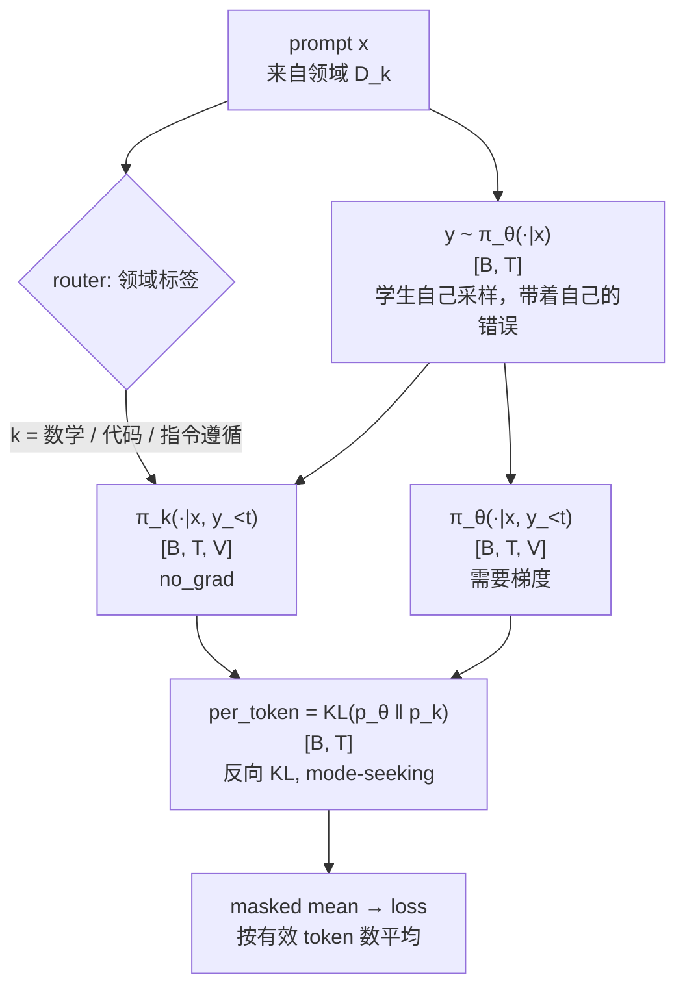

# 多教师在线策略蒸馏 (Multi-Teacher On-Policy Distillation)

> 每个领域一个教师，按 prompt 路由，在学生自己的轨迹上逐 token 蒸馏

## 📌 原理与思想

### 核心概念
多教师在线策略蒸馏（MOPD）解决的是「把多个各自专精的教师模型合并进同一个学生」的问题：先对每个领域分别做强化学习得到领域教师（数学、代码、指令遵循等），再让学生在自己的 on-policy 轨迹上、按 prompt 路由到对应教师做逐 token 蒸馏。能力融合发生在策略空间（学生输出的分布）里，而不是把多个教师的数据混在一起再训、串行训练或直接合并权重。相比单教师 OPD，MOPD 多了一层「路由」：每个 prompt 由领域标签决定跟哪个教师学，不同教师不会在同一段轨迹上争抢监督；相比多任务 RL，领域教师可以并行、独立地训练到各自最优，最后由一次蒸馏完成整合，避免域间梯度互相拉扯。代价是要同时维护多个教师、路由错误会直接变成错误的监督，而且各领域的 token 份额不均衡会带来能力偏置。

### 核心思想
分工训练、统一融合：每个教师只在自己的领域内是权威。学生自己采样出轨迹后，由轨迹所属领域的教师来打分 —— 一段轨迹只接受一个教师的监督，避免多个教师在同一 token 上互相打架。蒸馏发生在学生自己的状态分布上（policy space），而不是教师生成的离线数据（data space）或参数平均（weight space），所以既没有 exposure bias，也不受参数干涉影响。方向用反向 KL：mode-seeking 让学生对齐每个教师的高概率行为，路由则把监督精确投放到对应的能力上。

### 算法步骤
1. 从同一基座出发，对每个领域分别做 RL（SFT → RL），得到 K 个领域教师 π_1, …, π_K；它们彼此独立，可以并行训练。
2. 学生 π_θ 对来自各领域的 prompt 自己采样轨迹 y ~ π_θ(·|x)，同时保留每个 prompt 的领域标签。
3. 路由：按领域标签为每个样本选出对应教师 π_{T(x)}；没有归属教师的 prompt 用一份冻结的学生副本 π^(0) 当参考。
4. 教师对整条学生轨迹做一次前向并 detach，学生做带梯度的前向；逐 token 计算反向 KL（或等价的对数概率差 advantage），只在学生采样出的 token 上回传。
5. 按有效 token 数归一化后更新学生；可以多轮迭代，教师池也可以随训练继续更新。

## 📐 核心公式

```math
\mathcal{L}_{\text{MOPD}}(\theta)=\mathbb{E}_{x\sim\mathcal{D}}\ \mathbb{E}_{y\sim\pi_\theta(\cdot\mid x)}\left[\frac{1}{|y|}\sum_{t=1}^{|y|}D_{\mathrm{KL}}\!\left(\pi_\theta(\cdot\mid x,y_{<t})\ \|\ \pi_{T(x)}(\cdot\mid x,y_{<t})\right)\right]
```

```math
\begin{aligned}
\hat{A}_t&=\mathrm{sg}\left[\log\pi_{T(x)}(y_t\mid x,y_{<t})-\log\pi_\theta(y_t\mid x,y_{<t})\right]\\[2pt]
\mathcal{L}&=-\mathbb{E}_{y\sim\pi_\theta(\cdot\mid x)}\left[\frac{1}{|y|}\sum_t \hat{A}_t\,\log\pi_\theta(y_t\mid x,y_{<t})\right]
\end{aligned}
```

```math
D_{\mathrm{KL}}^{\text{full}}(t)=\sum_{v\in\mathcal{V}}p_\theta(v\mid x,y_{<t})\Big[\log p_\theta(v\mid x,y_{<t})-\log\pi_{T(x)}(v\mid x,y_{<t})\Big]
```

```math
T(x)=k\ \ \text{if}\ \ x\in\mathcal{D}_k,
\qquad
\pi_{\text{ref}}=\alpha\,\pi_{T(x)}+(1-\alpha)\,\pi^{(0)},\quad \alpha\in[0,1]
```

## 📊 张量流程图



## 💻 代码实现

```python
import torch
import torch.nn.functional as F

def mopd_loss(student_logits, teacher_logits, teacher_ids, loss_mask=None,
              temperature=1.0):
    """
    student_logits: [B, T, V]  学生 on-policy rollout 上的 logits（需要梯度）
    teacher_logits: list[K]，每个 [B, T, V]，第 k 个教师对整批样本的 logits
    teacher_ids:    [B]        每个 prompt 按领域标签路由到的教师下标
    loss_mask:      [B, T]     1 = 学生在该位置真实采样出的 token
    """
    B = student_logits.size(0)
    t_all = torch.stack(teacher_logits, dim=0)                # [K, B, T, V]
    t_routed = t_all[teacher_ids, torch.arange(B)].detach()   # [B, T, V]

    s_logp = F.log_softmax(student_logits / temperature, dim=-1)
    t_logp = F.log_softmax(t_routed / temperature, dim=-1)

    # 精确反向 KL：Σ_v p_θ (log p_θ − log p_T)
    per_token = (s_logp.exp() * (s_logp - t_logp)).sum(dim=-1)  # [B, T]

    if loss_mask is None:
        return per_token.mean()
    mask = loss_mask.float()
    return (per_token * mask).sum() / mask.sum().clamp_min(1.0)


def mopd_advantage(student_logits, teacher_logits, teacher_ids, sampled_ids):
    """采样 token 估计器：Â_t = sg[log π_T(y_t) − log π_θ(y_t)]，只回传 log π_θ"""
    B = student_logits.size(0)
    t_all = torch.stack(teacher_logits, dim=0)
    t_routed = t_all[teacher_ids, torch.arange(B)].detach()

    s_logp = F.log_softmax(student_logits, dim=-1)
    t_logp = F.log_softmax(t_routed, dim=-1)

    idx = sampled_ids.unsqueeze(-1)
    adv = t_logp.gather(-1, idx) - s_logp.gather(-1, idx)   # [B, T, 1]
    return adv.squeeze(-1).detach()


if __name__ == "__main__":
    torch.manual_seed(0)
    B, T, V, K = 2, 4, 8, 3
    student = torch.randn(B, T, V, requires_grad=True)
    teachers = [torch.randn(B, T, V) for _ in range(K)]
    teacher_ids = torch.tensor([0, 2])          # 样本 0 → 教师 0，样本 1 → 教师 2
    mask = torch.ones(B, T)
    mask[:, -1] = 0

    loss = mopd_loss(student, teachers, teacher_ids, mask)
    print("mopd loss:", loss.item())

    y = torch.randint(0, V, (B, T))
    adv = mopd_advantage(student, teachers, teacher_ids, y)
    print("per-token advantage:", tuple(adv.shape))

    loss.backward()
    print("学生一侧收到梯度:", student.grad is not None)
```

## 🎯 面试要点

- **为什么要多教师**: 单个 RL 任务里混多个领域，梯度会互相拉扯、出现跷跷板；先让每个领域教师独立训到最强（可并行），再由一次蒸馏把能力整合进一个学生，域与域之间解耦
- **为什么在策略空间融合**: 权重平均 / 模型合并受参数干涉影响；离线蒸馏只能学教师生成的静态数据。MOPD 让学生在自己的状态上对齐教师分布，融合的是行为而不是参数
- **为什么是 on-policy + 反向 KL**: 学生自己采样，消除 exposure bias；反向 KL 是 mode-seeking，且只需学生样本就能估计梯度 —— REINFORCE 形式的 advantage 恰好是 log π_T − log π_θ，和 on-policy rollout 天然匹配
- **路由是一把双刃剑**: 按 prompt 领域标签硬路由最简单，但路由错了就把错误监督直接灌进梯度；后续工作用 token 级路由（MOPD-Router）或可靠性加权（TrustMOPD）替代 prompt 级硬路由
- **没有教师的样本怎么办**: 用一份冻结的初始学生（self-anchor）当参考做 KL 正则，防止在无归属领域上漂移；也可以把教师与 anchor 按 α 混合成 proximal teacher（常见 α = 0.2）
- **能力不均衡**: 不同任务的回答长度差异巨大，按 token 平均会让长回答任务主导梯度 —— 已有工作观察到指令遵循任务占 20.3% 的 prompt 却只贡献约 0.99% 的梯度 token，需要按域重加权或分配采样预算
- **同源教师更稳**: 教师与学生从同一基座出发时分布差距可控、KL 优化稳定；跨源教师可以用「相对各自 base 的 logit 偏移」做 Δ 蒸馏来对齐
- **效果与落地**: 原论文在 Qwen3-30B-A3B 上把数学、指令遵循、SWE 三域的归一化得分从最佳基线 0.882 提到 0.937，并已用于 MiMo-V2-Flash 等工业级后训练
- **面试常问**: MOPD 和 OPD、多任务 RL、模型合并分别是什么关系？没有领域标签时怎么路由？
