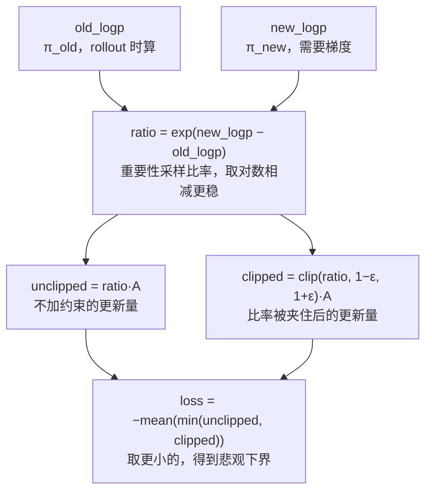

# PPO 损失 (Proximal Policy Optimization)

> 截断重要性采样比率，RLHF 核心

## 📌 原理与思想

### 核心概念
通过截断重要性采样比率 r_t = π_new/π_old 到 [1-ε, 1+ε]，限制策略更新幅度，防止策略崩溃。相比普通策略梯度容易更新过大导致崩溃，PPO 通过 clip 机制保证训练稳定性，是 ChatGPT/InstructGPT 的 RLHF 核心算法。

### 核心思想
重要性采样比率 r_t 衡量新旧策略的差异。通过 clip 将 r_t 限制在 [1-ε, 1+ε] 范围内，当 A>0 时防止 ratio 过大（过度奖励），当 A<0 时防止 ratio 过小（过度惩罚），实现保守更新。

### 算法步骤
1. 计算重要性采样比率：ratio = exp(new_logp - old_logp)
2. 截断比率：clipped = clamp(ratio, 1-ε, 1+ε)
3. 计算未截断代理损失：surr1 = ratio × advantages
4. 计算截断代理损失：surr2 = clipped × advantages
5. 取较小值：loss = -mean(min(surr1, surr2))

## 📐 核心公式

```math
\mathcal{L}_{\text{PPO}}=-\mathbb{E}_t\left[\min\!\left(r_tA_t,\ \text{clip}(r_t,\,1-\epsilon,\,1+\epsilon)\,A_t\right)\right]
```

```math
r_t=\exp\!\left(\log\pi_\theta^{\text{new}}-\log\pi_\theta^{\text{old}}\right),
\qquad
A_t=\text{GAE advantage},
\qquad
\epsilon=0.2
```

```math
\begin{aligned}
A_t>0:\ &\quad r_t>1+\epsilon\ \Rightarrow\ r_tA_t\ \text{capped at}\ (1+\epsilon)A_t\\[2pt]
A_t<0:\ &\quad r_t<1-\epsilon\ \Rightarrow\ r_tA_t\ \text{floored at}\ (1-\epsilon)A_t
\end{aligned}
```

## 📊 张量流程图



## 💻 代码实现

```python
import torch

def ppo_loss(old_logp, new_logp, advantages, eps=0.2):
    """
    PPO 截断损失
    
    old_logp, new_logp: [B]  对数概率
    advantages: [B]  优势估计 (GAE)
    """
    ratio = torch.exp(new_logp - old_logp)           # r_t
    clipped = torch.clamp(ratio, 1-eps, 1+eps)       # clip(r_t)

    surr1 = ratio * advantages                        # 未截断
    surr2 = clipped * advantages                      # 截断

    return -torch.min(surr1, surr2).mean()            # 保守更新

# 完整 PPO 训练流程
class PPOTrainer:
    def __init__(self, policy_model, ref_model, reward_model, critic_model,
                 optimizer, ppo_epochs=4, kl_coef=0.02):
        self.policy = policy_model
        self.ref = ref_model
        self.reward = reward_model
        self.critic = critic_model
        self.optimizer = optimizer
        self.ppo_epochs = ppo_epochs
        self.kl_coef = kl_coef
    
    def train_step(self, prompts, responses):
        # 1~3 步算出来的都是「只当基准的常量」：reward / value / advantage / old_logp
        # 在下面 4 个 epoch 里会被反复用到，必须在 no_grad 下算 —— 否则第二次
        # backward 要去访问第一次已经释放的图，直接报错；梯度还会往冻结的模型上累
        with torch.no_grad():
            # 1. 计算 reward（奖励模型是冻结的，输出只当常量用）
            rewards = self.reward(prompts, responses)

            # 2. 计算 value 和 advantage：用更新前的 critic，算完就是常量
            #    （critic 自己的 value loss 要另走一次带梯度的前向，不能复用这里）
            values = self.critic(prompts, responses)
            advantages = compute_gae(rewards, values)

            # 3. 计算 old log probs：更新前算，它是比值的基准常量，
            #    若和 new_logp 一样由当前策略现算，ratio 恒等于 1、梯度就没了
            old_logp = self.policy.get_logprobs(prompts, responses)

            # 参考模型的 logp 与策略无关、全程不变：算一次就够，
            # 更不能带梯度 —— 每个 epoch 重建一遍图纯属浪费
            ref_logp = self.ref.get_logprobs(prompts, responses)

        # 4. PPO 更新
        for _ in range(self.ppo_epochs):
            new_logp = self.policy.get_logprobs(prompts, responses)
            loss = ppo_loss(old_logp, new_logp, advantages)

            # KL penalty (防止偏离参考模型太远)
            kl = (new_logp - ref_logp).mean()
            loss += self.kl_coef * kl

            self.optimizer.zero_grad()
            loss.backward()
            self.optimizer.step()

# 测试
if __name__ == "__main__":
    B = 32
    old_logp = torch.randn(B)
    new_logp = old_logp + torch.randn(B) * 0.1
    advantages = torch.randn(B)
    
    loss = ppo_loss(old_logp, new_logp, advantages, eps=0.2)
    print(f"PPO Loss: {loss.item():.4f}")
```

## 🎯 面试要点

- **ratio = exp(new_logp - old_logp)** 重要性采样比率
- **clip 到 [1-ε, 1+ε]** 限制更新幅度
- **A>0**: 防止 ratio 过大 → 停止奖励
- **A<0**: 防止 ratio 过小 → 停止惩罚
- **ChatGPT/InstructGPT 的 RLHF 核心算法**
- **需要 reward model + critic model + reference model**
- **面试常问**: PPO 的 clip 机制是如何工作的？
- ε 通常取 0.2；ratio 必须用旧策略的 logp 现算，rollout 与更新要严格配对

