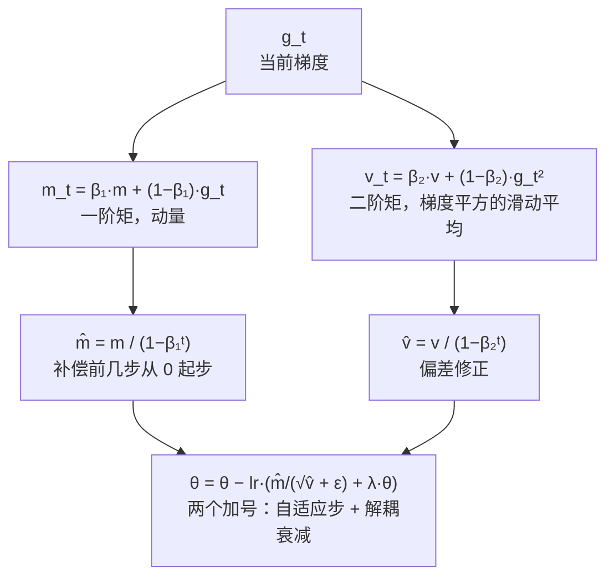

# AdamW 优化器

> 解耦权重衰减，LLM 训练标配

## 📌 原理与思想

### 核心概念
Adam 的改进版：将权重衰减从梯度中解耦，直接作用于参数。相比 Adam 的权重衰减作用在梯度上正则化效果差，AdamW 解耦后正则化效果更好，是 LLM 训练的标准优化器。

### 核心思想
维护一阶矩（动量）和二阶矩（未中心化的方差），通过偏差修正确保初始阶段的稳定性。权重衰减直接作用于参数而非梯度，实现解耦正则化。

### 算法步骤
1. 更新一阶矩：m_t = β₁·m + (1-β₁)·g
2. 更新二阶矩：v_t = β₂·v + (1-β₂)·g²
3. 偏差修正：m̂ = m/(1-β₁ᵗ), v̂ = v/(1-β₂ᵗ)
4. 解耦权重衰减：θ = θ - lr·λ·θ
5. 参数更新：θ = θ - lr·m̂/(√v̂ + ε)

## 📐 核心公式

```math
\begin{aligned}
m_t &= \beta_1 m_{t-1}+(1-\beta_1)\,g_t\\[2pt]
v_t &= \beta_2 v_{t-1}+(1-\beta_2)\,g_t^{2}\\[2pt]
\hat{m}_t &= \frac{m_t}{1-\beta_1^{t}},\qquad
\hat{v}_t=\frac{v_t}{1-\beta_2^{t}}\\[2pt]
\theta_t &= \theta_{t-1}-\eta\left(\frac{\hat{m}_t}{\sqrt{\hat{v}_t}+\epsilon}+\lambda\,\theta_{t-1}\right)
\end{aligned}
```

```math
\eta=3\times10^{-4},\qquad (\beta_1,\beta_2)=(0.9,\ 0.95),\qquad \lambda=0.1,\qquad \epsilon=10^{-8}
```

## 📊 张量流程图



## 💻 代码实现

```python
import torch, math

class AdamW:
    # β₂ 取 0.95，不是 PyTorch 默认的 0.999：这是 LLM 训练的经验标配
    # （GPT-3 / LLaMA 一路沿用），上方公式和面试要点给的也是这一组
    def __init__(self, params, lr=1e-3, betas=(0.9, 0.95),
                 eps=1e-8, weight_decay=0.01):
        self.params = list(params)
        self.lr, self.eps = lr, eps
        self.b1, self.b2 = betas
        self.wd = weight_decay
        self.m = [torch.zeros_like(p) for p in self.params]
        self.v = [torch.zeros_like(p) for p in self.params]
        self.t = 0

    def step(self):
        self.t += 1
        for i, p in enumerate(self.params):
            if p.grad is None:
                continue
            g = p.grad.data
            
            # 解耦权重衰减 (AdamW vs Adam 的关键区别)
            if self.wd != 0:
                p.data.mul_(1 - self.lr * self.wd)
            
            # 更新矩
            self.m[i] = self.b1 * self.m[i] + (1-self.b1) * g
            self.v[i] = self.b2 * self.v[i] + (1-self.b2) * g**2
            
            # 偏差修正 + 更新
            m_hat = self.m[i] / (1 - self.b1**self.t)
            v_hat = self.v[i] / (1 - self.b2**self.t)
            p.data.add_(-self.lr * m_hat / (v_hat.sqrt() + self.eps))

# 学习率调度 (LLM 标配)
def cosine_schedule_with_warmup(step, warmup_steps, total_steps,
                                max_lr=3e-4, min_lr=3e-5):
    """warmup 线性升到 max_lr，再余弦退火到 min_lr（一般取 max_lr 的 10%，不退到 0）"""
    if step < warmup_steps:
        return max_lr * (step / warmup_steps)
    # progress 必须夹到 [0, 1]：步数跑过 total_steps 时 progress > 1，cos 会继续往前走，
    # 学习率不但不停在最小值，反而重新往上爬 —— warmup=100 / total=1000 时，
    # step=2000 会返回 0.97·max_lr，等于又从头跑一轮
    progress = min(1.0, (step - warmup_steps) / (total_steps - warmup_steps))
    return min_lr + (max_lr - min_lr) * 0.5 * (1 + math.cos(math.pi * progress))

# 测试
if __name__ == "__main__":
    torch.manual_seed(0)

    # ---------- 1) 偏差修正：第一步的位移正好是 lr ----------
    p = torch.tensor([1.0], requires_grad=True)
    opt = AdamW([p], lr=3e-4, weight_decay=0.0)     # 先关掉衰减，只看自适应步
    p.grad = torch.tensor([1.0])
    before = p.item()
    opt.step()
    print(f"第一步 |Δθ| = {before - p.item():.2e}  (lr = 3e-4)")
    # t=1 时 m̂ = m/(1−β₁) = g、v̂ = v/(1−β₂) = g²，比值 m̂/(√v̂+ε) 恒为 ±1，
    # 所以位移与梯度大小无关；不做修正则只有 0.1/√0.05 ≈ 0.447 倍
    print(f"不做偏差修正的话第一步只有 {0.1 / math.sqrt(0.05):.3f}·lr "
          f"，差 {1 - 0.1 / math.sqrt(0.05):.1%}")

    # ---------- 2) 解耦衰减：位移 = lr·wd·|θ| ----------
    p2 = torch.tensor([1.0], requires_grad=True)
    opt2 = AdamW([p2], lr=3e-4, weight_decay=0.1)
    p2.grad = torch.zeros(1)                        # 梯度为 0：自适应步为 0，只剩衰减
    opt2.step()
    print(f"解耦：|Δθ| = {1.0 - p2.item():.2e}  (= lr·wd·|θ| = {3e-4 * 0.1:.2e})")

    # 对照 Adam 的做法：把 λθ 混进梯度，再被 1/√v̂ 归一化。由上一步可知比值恒为 1，
    # 位移直接变成 lr —— 衰减量与 wd、与 θ 多大都无关，这正是「耦合」失控的地方
    def coupled_step(decay_grad):
        q = torch.tensor([1.0], requires_grad=True)
        o = AdamW([q], lr=3e-4, weight_decay=0.0)   # 衰减项下面手工混进梯度
        q.grad = torch.tensor([decay_grad])
        o.step()
        return 1.0 - q.item()

    print(f"耦合：λθ = 0.1 时 |Δθ| = {coupled_step(0.1):.2e} / λθ = 3.0 时 {coupled_step(3.0):.2e}"
          f" —— 都是 lr，参数大 30 倍衰减量一点没变")

    # ---------- 3) 学习率调度 ----------
    W, T, MAX_LR, MIN_LR = 100, 1000, 3e-4, 3e-5
    for s in (0, 50, 100, 550, 1000):
        print(f"step {s:>4}: {cosine_schedule_with_warmup(s, W, T, MAX_LR, MIN_LR):.2e}")
    # 跑过 total_steps 必须停住：不夹 progress 的话 cos 会继续往前走，学习率重新往上爬
    over = cosine_schedule_with_warmup(2 * T, W, T, MAX_LR, MIN_LR)
    unclamped = MIN_LR + (MAX_LR - MIN_LR) * 0.5 * (
        1 + math.cos(math.pi * (2 * T - W) / (T - W)))
    print(f"step {2 * T}（已超 total_steps）: 夹住 {over:.2e} / 不夹 {unclamped:.2e}"
          f" = max_lr 的 {unclamped / MAX_LR:.0%}（注释里说的 0.97）")
    print(f"峰值 {cosine_schedule_with_warmup(W, W, T, MAX_LR, MIN_LR):.2e} = max_lr，"
          f"末尾退到 min_lr = max_lr 的 {MIN_LR / MAX_LR:.0%}")
```

## 🎯 面试要点

- **AdamW vs Adam**: 权重衰减直接作用于参数，非梯度
- **偏差修正**解决初始阶段 m,v 偏小的问题
- **LLM 标配**: lr=3e-4, betas=(0.9,0.95), wd=0.1
- **配合 cosine schedule with warmup** 使用
- **面试常问**: AdamW 和 Adam 的区别？为什么要解耦权重衰减？
- **解耦为什么重要**: Adam 把 λθ 加进梯度再被 1/√v̂ 归一化，衰减强度会随梯度尺度失控；LLM 标配 lr=3e-4、betas=(0.9, 0.95)、weight_decay=0.1

