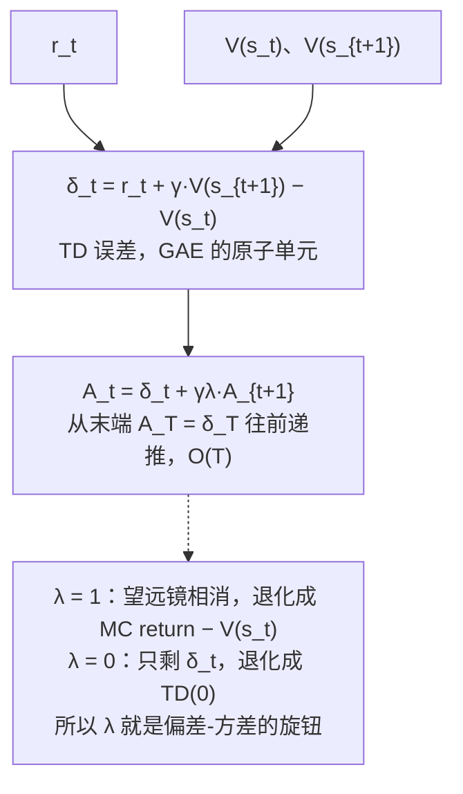

# 广义优势估计 (GAE)

> 偏差-方差折衷的 λ-return 优势估计

## 📌 原理与思想

### 核心概念
通过 λ 参数在蒙特卡洛（低偏差高方差）和 TD(0)（高偏差低方差）之间折衷。λ=1 等价于 MC（无偏差但高方差），λ=0 等价于 TD(0)（高偏差但低方差），GAE 通过 λ 在两者之间取得平衡。

### 核心思想
利用 TD error 的指数加权求和来估计优势函数。通过 λ 参数控制不同时间步 TD error 的权重，实现偏差-方差的折衷。

### 算法步骤
1. 计算 TD error：δ_t = r_t + γ·V(s_{t+1}) - V(s_t)
2. 从后向前递推：A_t = δ_t + γλ·A_{t+1}
3. 计算 returns：returns = advantages + values[:-1]
4. 归一化优势（可选）：advantages = (advantages - mean) / std

## 📐 核心公式

```math
\delta_t=r_t+\gamma V(s_{t+1})-V(s_t)
```

```math
A_t=\sum_{l=0}^{T-t}(\gamma\lambda)^{l}\,\delta_{t+l}
=\delta_t+\gamma\lambda\,\delta_{t+1}+(\gamma\lambda)^{2}\delta_{t+2}+\cdots
```

```math
A_t=\delta_t+\gamma\lambda\,A_{t+1},\qquad A_T=\delta_T
```

```math
\begin{aligned}
\lambda=1: &\quad A_t=\text{MC return}-V(s_t) & \text{(unbiased, high variance)}\\[2pt]
\lambda=0: &\quad A_t=\delta_t & \text{(low variance, high bias)}
\end{aligned}
```

```math
\gamma=0.99,\qquad \lambda=0.95
```

## 📊 张量流程图



## 💻 代码实现

```python
import torch

def compute_gae(rewards, values, gamma=0.99, lam=0.95):
    """
    计算 GAE 优势
    
    rewards: [T]  每步奖励
    values:  [T+1] 价值估计 (含最后一步)
    
    返回: advantages [T], returns [T]
    """
    T = len(rewards)
    advantages = torch.zeros(T)
    gae = 0.0

    for t in reversed(range(T)):
        delta = rewards[t] + gamma * values[t+1] - values[t]
        gae = delta + gamma * lam * gae       # 递推!
        advantages[t] = gae

    returns = advantages + values[:-1]         # returns = A + V
    return advantages, returns

# 测试
if __name__ == "__main__":
    T = 10
    rewards = torch.randn(T)
    values = torch.randn(T + 1)
    
    advantages, returns = compute_gae(rewards, values, gamma=0.99, lam=0.95)
    print(f"Advantages shape: {advantages.shape}")  # [10]
    print(f"Returns shape: {returns.shape}")        # [10]
    
    # 验证: returns = advantages + values[:-1]
    assert torch.allclose(returns, advantages + values[:-1])

# PPO 中使用
def ppo_step(model, optimizer, data, gamma=0.99, lam=0.95):
    # advantages / old_logp 都是「比值的基准常量」，必须在 no_grad 下算：
    # 它们在循环外只算一次，却会被 4 个 epoch 各反向一次，
    # 第二次反向要去访问第一次已经释放的图 → RuntimeError
    with torch.no_grad():
        rewards = data['rewards']
        values = model.compute_values(data['states'])
        advantages, returns = compute_gae(rewards, values, gamma, lam)
        # 归一化优势
        advantages = (advantages - advantages.mean()) / (advantages.std() + 1e-8)
        old_logp = model.get_logprobs(data['states'], data['actions'])
    # returns 用来算 critic 的 value loss，这里省略

    # PPO 更新
    for _ in range(4):  # PPO epochs
        new_logp = model.get_logprobs(data['states'], data['actions'])
        loss = ppo_loss(old_logp, new_logp, advantages)
        optimizer.zero_grad()      # 少了它梯度会跨 epoch 累加
        loss.backward()
        optimizer.step()           # 少了它参数根本没更新
```

## 🎯 面试要点

- **λ 控制偏差-方差折衷**: λ=1 无偏差高方差, λ=0 高偏差低方差
- **递推实现 O(T)**: A_t = δ_t + γλ·A_{t+1}
- **通常 γ=0.99, λ=0.95**
- **PPO 训练的标准优势估计方法**
- **优势与 old_logp 都要 detach / no_grad**: 它们是比值的基准常量，若带着图在多个 PPO epoch 里反复反向，第二次就会撞上「图已释放」的 RuntimeError
- **GRPO 不需要 GAE** (用组内归一化代替)
- **面试常问**: GAE 的 λ 参数有什么作用？


