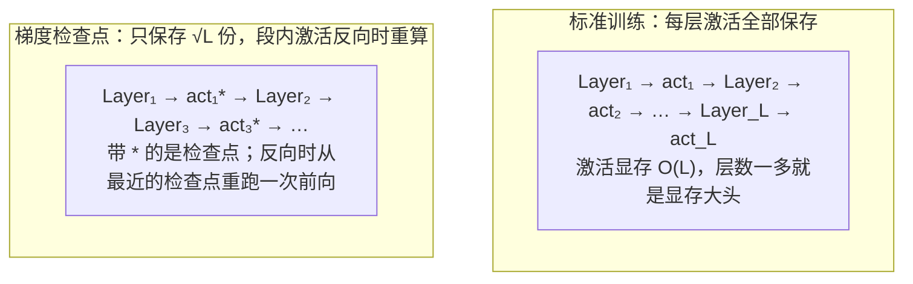

# 梯度检查点 (Gradient Checkpointing)

> 时间换空间，重新计算代替存储激活

## 📌 原理与思想

### 核心概念
不保存所有中间激活值，只保存检查点。反向传播时重新计算需要的激活值。相比标准训练保存所有层激活（显存 O(L)），梯度检查点只保存 √L 个检查点（显存 O(√L)），用约 20% 额外计算换取大量显存。

### 核心思想
时间换空间：不保存所有中间激活值，只保存关键检查点。反向传播时从最近的检查点重新计算需要的激活值，大幅减少显存占用。

### 算法步骤
1. 前向传播时只保存检查点（如每 √L 层保存一次）
2. 反向传播时从检查点重新计算需要的激活值
3. 使用 torch.utils.checkpoint 包裹需要检查点的层
4. HuggingFace 模型可直接设置 gradient_checkpointing=True

## 📐 核心公式

```math
\text{activations}: O(L)\ \longrightarrow\ O\!\left(\sqrt{L}\right)
```

```math
\text{memory}: L\,B\,S\,d\cdot 4\ \text{B}\ \longrightarrow\ \sqrt{L}\,B\,S\,d\cdot 4\ \text{B}
```

```math
\text{checkpoints}=\sqrt{L},\qquad \text{time overhead}\approx 20\%
```

## 📊 张量流程图



## 💻 代码实现

```python
import torch
import torch.nn as nn
from torch.utils.checkpoint import checkpoint

# 方法1: 用 checkpoint 包裹任意前向函数 —— 中间激活不保存，反向时重算
def custom_forward(x, weight1, weight2):
    return torch.relu(x @ weight1) @ weight2

# 直接跑通的最小示例（真实训练里 weight1/weight2 是 nn.Parameter）
x = torch.randn(4, 16, requires_grad=True)
weight1 = torch.randn(16, 64, requires_grad=True)
weight2 = torch.randn(64, 8, requires_grad=True)
output = checkpoint(custom_forward, x, weight1, weight2, use_reentrant=False)
output.sum().backward()
print("方法1 梯度已回传:", weight1.grad is not None)   # True

# 方法2: HuggingFace 模型直接开启（需要 pip install transformers）
from transformers import AutoModel

model = AutoModel.from_pretrained(
    "model_name",
    gradient_checkpointing=True    # 一行开启
)

# 方法3: 在 Transformer 里逐层包裹
class TransformerBlock(nn.Module):
    """attn / ffn / norm 的实现见「多头注意力」「FFN / SwiGLU」「RMSNorm」三题"""

    def __init__(self, d_model, n_heads, use_checkpoint=False):
        super().__init__()
        self.attn = MultiHeadAttention(d_model, n_heads)
        self.ffn = FFN(d_model)
        self.norm1 = RMSNorm(d_model)
        self.norm2 = RMSNorm(d_model)
        self.use_checkpoint = use_checkpoint

    def forward(self, x, mask=None):
        if self.use_checkpoint:
            # MHA 的签名是 forward(xq, xk=None, mask=None)，mask 是第三个参数：
            # 中间必须留一个 None 占位，否则 mask 会被当成 xk 传进去
            x = x + checkpoint(self.attn, self.norm1(x), None, mask, use_reentrant=False)
            return x + checkpoint(self.ffn, self.norm2(x), use_reentrant=False)
        x = x + self.attn(self.norm1(x), None, mask)
        return x + self.ffn(self.norm2(x))


def build_model(use_checkpoint=False, d_model=512, n_layers=4):
    """最小的 L 层模型，仅用于下面的显存对比"""
    return nn.Sequential(*[TransformerBlock(d_model, 8, use_checkpoint)
                           for _ in range(n_layers)])


# 测试显存节省（需要 CUDA）
def measure_memory(use_checkpoint=False):
    """测量峰值显存：checkpoint 省下的就是这里少存的那批激活"""
    model = build_model(use_checkpoint=use_checkpoint).cuda()
    x = torch.randn(4, 2048, 512, device='cuda', requires_grad=True)

    torch.cuda.reset_peak_memory_stats()
    loss = model(x).sum()
    loss.backward()

    peak_memory = torch.cuda.max_memory_allocated() / 1e9
    print(f"use_checkpoint={use_checkpoint}: Peak memory {peak_memory:.2f} GB")
    return peak_memory

# 对比
if __name__ == "__main__":
    mem1 = measure_memory(use_checkpoint=False)
    mem2 = measure_memory(use_checkpoint=True)
    print(f"\nMemory saved: {(mem1 - mem2):.2f} GB ({(1 - mem2/mem1)*100:.1f}%)")
```

## 🎯 面试要点

- **用 ~20% 额外计算时间换取大量显存**
- **显存从 O(L) 降到 O(√L)**
- **HuggingFace 模型一行开启**: `gradient_checkpointing=True`
- **常与 LoRA 配合**: LoRA 减少参数 + 检查点减少激活
- **use_reentrant=False** 是新版推荐设置
- **面试常问**: 梯度检查点的原理？代价是什么？
- 省下来的显存可以直接换成更大的 batch 或更长的序列

