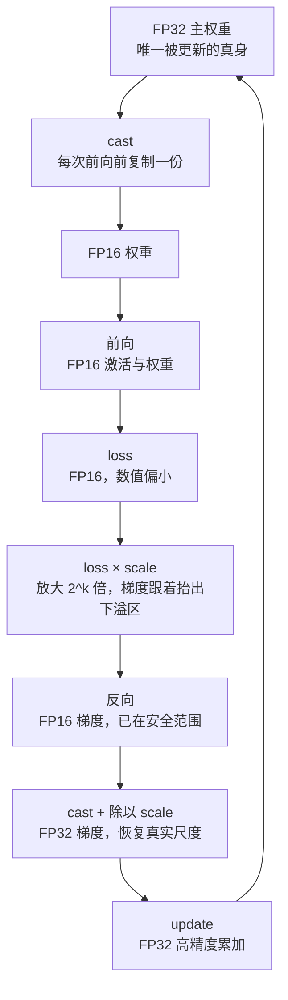

# 混合精度训练 (Mixed Precision Training)

> FP16/BF16 计算 + FP32 主权重

## 📌 原理与思想

### 核心概念
使用前向/反向用 FP16/BF16 减少显存和加速计算，但保持 FP32 主权重防止精度损失。FP16/BF16 只需 2 bytes（显存减半、计算加速），FP32 需 4 bytes（精度高），混合使用实现既快又准。配合 loss scaling 防止梯度下溢。

### 核心思想
前向和反向传播使用低精度（FP16/BF16）加速计算并减少显存，但主权重始终保持 FP32 防止精度损失。BF16 指数位更多（8 vs 5），不需要 loss scaling。

### 算法步骤
1. FP32 主权重 → copy → FP16 权重
2. FP16 前向传播 → FP16 loss
3. Loss scaling：loss × loss_scale
4. FP16 反向传播 → FP16 梯度
5. 梯度转 FP32 → 更新 FP32 主权重

## 📐 核心公式

```math
\text{value}=(-1)^{s}\cdot 2^{\,e-\text{bias}}\cdot(1.m)
```

```math
\begin{aligned}
\text{FP32}: &\quad 1+8+23\ \text{bits}\\[2pt]
\text{FP16}: &\quad 1+5+10\ \text{bits}\\[2pt]
\text{BF16}: &\quad 1+8+7\ \text{bits}
\end{aligned}
```

```math
\begin{aligned}
\text{forward / backward}: &\quad \text{FP16}\ (2\ \text{B})\\[2pt]
\text{master weights}: &\quad \text{FP32}\ (4\ \text{B})\\[2pt]
\text{gradient}: &\quad g_{\text{FP16}}\ \longrightarrow\ \text{FP32}
\end{aligned}
```

```math
\mathcal{L}'\leftarrow S\cdot\mathcal{L},
\qquad
g\leftarrow\frac{\text{cast}\!\left(g_{\text{FP16}}\right)}{S},
\qquad
\text{BF16}:\ e_{\text{bits}}=8\ \Rightarrow\ S=1
```

## 📊 张量流程图



## 💻 代码实现

```python
import torch

# 方法1: PyTorch 原生 AMP (Automatic Mixed Precision)
scaler = torch.amp.GradScaler('cuda')

# 下面这段要贴进训练循环里，model / optimizer / dataloader 由调用方提供
# lint:allow model optimizer dataloader
for batch in dataloader:
    optimizer.zero_grad()
    
    # 自动将操作转为 FP16
    with torch.amp.autocast('cuda'):
        loss = model(batch)
    
    # Loss scaling 防止梯度下溢
    scaler.scale(loss).backward()
    scaler.step(optimizer)
    scaler.update()

# 方法2: BF16 更简单 (不需要 loss scaling)
with torch.amp.autocast('cuda', dtype=torch.bfloat16):
    loss = model(batch)
loss.backward()   # 直接反向，不需要 scaler
optimizer.step()

# 方法3: HuggingFace Trainer 自动处理
from transformers import Trainer, TrainingArguments

args = TrainingArguments(
    output_dir='./output',
    fp16=True,           # 使用 FP16
    # bf16=True,         # 或使用 BF16 (A100/H100 推荐)
    fp16_full_eval=True, # 评估也用 FP16
)
trainer = Trainer(model=model, args=args)
trainer.train()

# 验证混合精度
def check_mixed_precision(model):
    """看参数精度：AMP 不转权重，转的是算子 —— autocast 只在每个算子内部把输入
    临时降到 fp16/bf16，主权重始终是 fp32，所以这里打出来全是 torch.float32。
    （autocast 里真正被留在 fp32 的是少数算子，如 softmax / layernorm / loss。）
    真把权重变成 fp16/bf16 的是 model.half() / model.to(torch.bfloat16)，
    那是另一条路线 —— 没有 fp32 主权重兜底，更容易掉点。"""
    for name, param in model.named_parameters():
        print(f"{name}: {param.dtype}")      # torch.float32，不是 fp16
```

## 🎯 面试要点

- **FP16**: 1+5+10 bits, 需要 loss scaling 防梯度下溢
- **BF16**: 1+8+7 bits, 指数位多 → 不需要 loss scaling
- **显存减半 + 计算加速** (Tensor Core)
- **现代 GPU (A100/H100) 推荐 BF16**
- **主权重始终 FP32** 保证精度
- **面试常问**: FP16 和 BF16 的区别？为什么 BF16 不需要 loss scaling？


