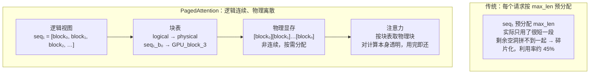

# 分页注意力 (PagedAttention)

> vLLM 核心，分页管理 KV Cache

## 📌 原理与思想

### 核心概念
借鉴操作系统虚拟内存的分页思想，将 KV Cache 分成固定大小的块（页），通过块表映射到非连续物理内存。相比传统 KV Cache 预分配 max_len 导致大量浪费和内存碎片，PagedAttention 按需分配，内存利用率可达 ~96%。

### 核心思想
逻辑块是连续的 token 块（如 16 tokens/block），物理块是 GPU 显存中的实际存储位置。通过块表（block table）将逻辑块映射到非连续的物理块，消除预分配浪费和内存碎片。

### 算法步骤
1. 预分配物理块池：physical_blocks = zeros(num_blocks, ...)
2. 为序列分配物理块：allocate(seq_id, num_tokens)
3. 写入 KV 到对应物理块：write(seq_id, position, key, value)
4. 注意力计算时从物理块 gather K/V
5. 序列结束时释放物理块：free(seq_id)

## 📐 核心公式

```math
\text{phys}(s,j)=\text{block\_table}[s][j]
```

```math
\text{utilization}=\frac{\sum_i\ell_i}{N_{\text{blocks}}\cdot B},
\qquad B=16\ \text{tokens/block}
```

```math
\text{naive}: \text{batch}\times S_{\max}\ \text{preallocated},
\qquad
\text{paged}: \sum_i\ell_i\ \text{allocated on demand}
```

```math
\text{utilization}: 45\%\ \longrightarrow\ 96\%
```

## 📊 张量流程图



## 💻 代码实现

```python
import torch

class PagedKVCache:
    def __init__(self, block_size=16, num_blocks=1000, n_layers=32,
                 n_heads=32, head_dim=128, device='cuda'):
        self.block_size = block_size
        self.physical_blocks = torch.zeros(
            num_blocks, n_layers, 2, block_size, n_heads, head_dim,
            dtype=torch.float16, device=device
        )
        self.block_tables = {}
        self.free_blocks = list(range(num_blocks))

    def allocate(self, seq_id, num_tokens):
        """为序列分配物理块"""
        num_blocks = (num_tokens + self.block_size - 1) // self.block_size
        if num_blocks > len(self.free_blocks):
            raise RuntimeError("Out of memory")
        
        allocated = self.free_blocks[:num_blocks]
        self.free_blocks = self.free_blocks[num_blocks:]
        self.block_tables[seq_id] = allocated

    def write(self, seq_id, layer, position, key, value):
        """把一个 token 在某层的 K/V 写进对应的物理块；key/value: [n_heads, head_dim]"""
        block_idx = position // self.block_size
        block_offset = position % self.block_size
        phys_id = self.block_tables[seq_id][block_idx]
        self.physical_blocks[phys_id, layer, 0, block_offset] = key
        self.physical_blocks[phys_id, layer, 1, block_offset] = value

    def attention(self, seq_id, layer, q, seq_len):
        """使用块表进行注意力计算"""
        phys_ids = self.block_tables[seq_id]
        k = self.physical_blocks[phys_ids, layer, 0]
        v = self.physical_blocks[phys_ids, layer, 1]
        return paged_attention_kernel(q, k, v, seq_len, self.block_size)

    def free(self, seq_id):
        """释放序列的块"""
        if seq_id in self.block_tables:
            self.free_blocks.extend(self.block_tables[seq_id])
            del self.block_tables[seq_id]

def paged_attention_kernel(q, k_blocks, v_blocks, seq_len, block_size=16):
    """q: [B, H, 1, D]；k_blocks / v_blocks: [n_blocks, block_size, H, D]"""
    
    B, H, _, D = q.shape
    
    k = k_blocks.reshape(-1, H, D)[:seq_len]
    v = v_blocks.reshape(-1, H, D)[:seq_len]
    k, v = k.transpose(0, 1), v.transpose(0, 1)
    
    scores = torch.matmul(q, k.transpose(-2, -1)) / (D ** 0.5)
    attn = torch.softmax(scores, dim=-1)
    output = torch.matmul(attn, v)
    
    return output

if __name__ == "__main__":
    torch.manual_seed(0)
    B, H, D, L = 1, 8, 64, 4
    cache = PagedKVCache(block_size=16, num_blocks=100, n_layers=L,
                         n_heads=H, head_dim=D, device='cpu')
    
    seq_len = 20
    cache.allocate(seq_id=1, num_tokens=seq_len)
    print(f"Allocated blocks for seq 1: {cache.block_tables[1]}")
    
    keys, values = [], []
    for pos in range(seq_len):
        key, value = torch.randn(H, D), torch.randn(H, D)
        keys.append(key)
        values.append(value)
        cache.write(1, layer=0, position=pos, key=key, value=value)
    
    q = torch.randn(B, H, 1, D)
    out = cache.attention(seq_id=1, layer=0, q=q, seq_len=seq_len)
    print(f"Attention output: {out.shape}")
    
    def plain_attention(q, k, v):
        k = torch.stack(k).transpose(0, 1)
        v = torch.stack(v).transpose(0, 1)
        scores = torch.matmul(q, k.transpose(-2, -1)) / (D ** 0.5)
        return torch.matmul(torch.softmax(scores, dim=-1), v)
    
    ref = plain_attention(q, keys, values)
    print(f"分页 vs 普通 KV 最大误差: {(out - ref).abs().max().item():.2e}")
    
    cache.allocate(seq_id=3, num_tokens=seq_len)
    for pos, (key, value) in enumerate(zip(keys, values)):
        cache.write(3, layer=0, position=pos, key=key, value=value)
    scattered = [77, 12]
    cache.physical_blocks[scattered] = cache.physical_blocks[cache.block_tables[3]].clone()
    cache.block_tables[3] = scattered
    for pid in scattered:
        cache.free_blocks.remove(pid)
    out_scattered = cache.attention(seq_id=3, layer=0, q=q, seq_len=seq_len)
    print(f"块表改成 {scattered}（不连续）后最大误差: "
          f"{(out_scattered - ref).abs().max().item():.2e}")
    
    padded = cache.attention(seq_id=1, layer=0, q=q,
                             seq_len=len(cache.block_tables[1]) * cache.block_size)
    print(f"不截断（32 个位置）与正确输出差: {(padded - out).abs().max().item():.3f}"
          f"（输出量级 {out.abs().max().item():.3f}）")
    
    print(f"块内利用率 {seq_len / (len(cache.block_tables[1]) * cache.block_size):.1%}（20/32）"
          f"；若按 max_len=512 预分配只有 {seq_len / 512:.1%}")
    
    free_before = len(cache.free_blocks)
    cache.free(3)
    print(f"释放 seq 3 后空闲块 {free_before} → {len(cache.free_blocks)}（+2 = 它占的块数），"
          f"块表里还留着吗: {3 in cache.block_tables}")
    
    cache.allocate(seq_id=2, num_tokens=20)
    print(f"Allocated blocks for seq 2: {cache.block_tables[2]}")
    print(f"Free blocks: {len(cache.free_blocks)}")
```

## 🎯 面试要点

- **借鉴 OS 虚拟内存分页思想**
- **逻辑块连续，物理块可以不连续**
- **消除预分配浪费和内存碎片**
- **内存利用率从 ~45% 提升到 ~96%**
- **vLLM 的核心创新**，大幅提升推理吞吐
- **支持 copy-on-write** 实现 beam search 的 KV 共享
- **面试常问**: PagedAttention 的原理？如何提高内存利用率？


