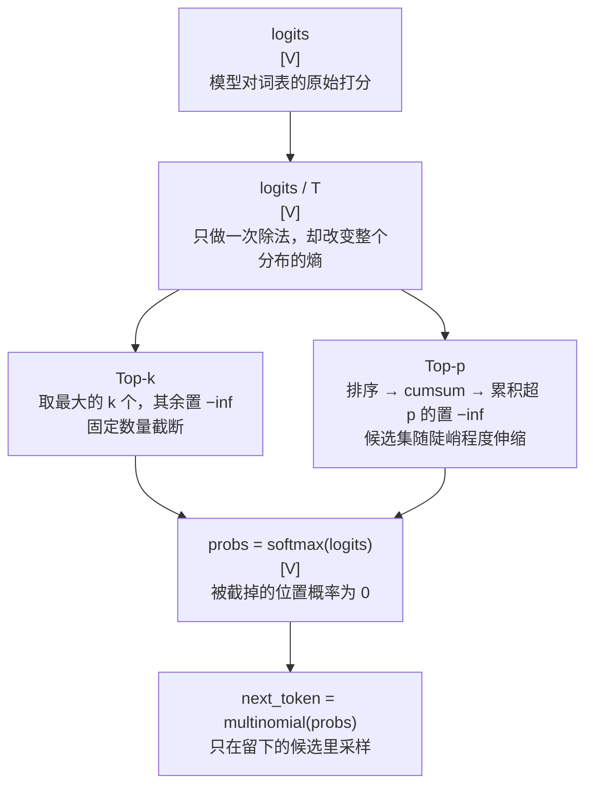

# 采样策略 (Sampling Strategies)

> 控制输出多样性：Temperature / Top-k / Top-p

## 📌 原理与思想

### 核心概念
Temperature 控制分布锐度；Top-k 只保留概率最高的 K 个 token；Top-p 保留累积概率达到 P 的最小集合。相比 Greedy（确定性但容易重复）和纯 Sampling（多样性但可能低质量），采样策略在质量和多样性之间取得平衡。实践中常组合使用。

### 核心思想
Temperature 通过除以温度参数 T 调整分布锐度（T<1 更确定，T>1 更随机）。Top-k 固定保留 K 个候选，Top-p 动态选择累积概率达到 P 的最小集合，后者更灵活。

### 算法步骤
1. 应用 Temperature：logits = logits / T
2. Top-k 过滤：只保留最大的 k 个，其余设为 -inf
3. Top-p 过滤：排序后累积概率超过 p 的设为 -inf
4. Softmax 归一化：probs = softmax(logits)
5. 多项式采样：next_token = multinomial(probs)

## 📐 核心公式

```math
P(x_i)=\frac{\exp(z_i/T)}{\sum_j\exp(z_j/T)}
```

```math
T<1:\ \text{sharper},\qquad T>1:\ \text{flatter},\qquad T\to 0:\ \text{greedy}
```

```math
\text{top-}k:\quad \mathcal{S}_k=\{i:\ \text{rank}(z_i)\le k\},
\qquad p_i\leftarrow 0\ \text{for}\ i\notin\mathcal{S}_k
```

```math
\text{top-}p:\quad \mathcal{S}_p=\min\left\{V'\subseteq V:\ \sum_{i\in V'}p_i\ge p\right\}
```

## 📊 张量流程图



## 💻 代码实现

```python
import torch
import torch.nn.functional as F

def top_k_top_p_sampling(logits, temperature=0.7, top_k=50, top_p=0.9):
    """组合采样策略：返回过滤后的 logits（-inf = 被截掉的候选），不负责采样"""
    logits = logits / temperature

    if top_k > 0:
        top_k_vals, _ = torch.topk(logits, top_k)
        threshold = top_k_vals[..., -1:]
        logits = logits.masked_fill(logits < threshold, float('-inf'))

    if top_p < 1.0:
        sorted_logits, sorted_idx = torch.sort(logits, descending=True)
        cum_probs = torch.cumsum(F.softmax(sorted_logits, dim=-1), dim=-1)
        mask = cum_probs > top_p
        mask[..., 1:] = mask[..., :-1].clone()
        mask[..., 0] = False
        sorted_logits[mask] = float('-inf')
        logits = sorted_logits.scatter(1, sorted_idx, sorted_logits)

    return logits

@torch.no_grad()
def generate(model, prompt_ids, max_new_tokens=100, temperature=0.7,
             top_k=50, top_p=0.9):
    input_ids = prompt_ids.clone()
    
    for _ in range(max_new_tokens):
        logits = model(input_ids).logits[:, -1, :]
        
        logits = top_k_top_p_sampling(logits, temperature, top_k, top_p)
        
        probs = F.softmax(logits, dim=-1)
        next_token = torch.multinomial(probs, num_samples=1)
        
        input_ids = torch.cat([input_ids, next_token], dim=1)
        
        if next_token.item() == model.config.eos_token_id:
            break
    
    return input_ids

# 测试
if __name__ == "__main__":
    V = 32000
    logits = torch.randn(1, V)
    
    for temperature in (0.1, 1.0, 2.0):
        filtered = top_k_top_p_sampling(logits, temperature=temperature,
                                        top_k=50, top_p=0.9)
        left = int((filtered > float('-inf')).sum())
        print(f"T={temperature}: 剩余候选 {left} 个")
```

## 🎯 面试要点

- **T<1**: 更确定 (适合翻译/代码); **T>1**: 更随机 (适合创作)
- **Top-k 固定数量**，Top-p 动态集合 → Top-p 更灵活
- **实践中通常组合**: 先 Top-k 再 Top-p
- **Greedy (T→0)** 可复现，sampling 不可复现
- **面试常问**: Temperature 的作用？Top-k 和 Top-p 的区别？


