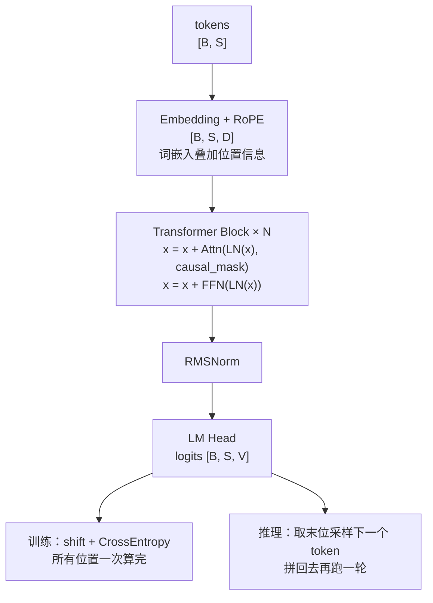

# Decoder-Only Transformer (GPT 架构)

> 因果注意力 + 自回归，现代 LLM 标配

## 📌 原理与思想

### 核心概念
只有 decoder 的 Transformer 架构。使用因果注意力（只能看到之前的 token），通过自回归方式逐 token 生成。相比 Encoder-Decoder 架构，Decoder-Only 统一训练和推理（训练时预测下一个 token，推理时生成），因果注意力保证自回归特性，适合生成任务。GPT/LLaMA/Mistral 等主流 LLM 都采用此架构。

### 核心思想
每层包含自注意力（带 causal mask）和 FFN，使用 Pre-Norm 结构（先归一化再进子层）。现代 LLM 标配：RMSNorm + SwiGLU + RoPE。

### 算法步骤
1. Token Embedding；位置信息由 RoPE 在每层注意力的 Q/K 上注入（不需要位置编码表）
2. 创建因果掩码：mask = tril(ones(S, S))
3. 逐层处理：x = x + Attn(LN(x), mask); x = x + FFN(LN(x))
4. 最终归一化：x = RMSNorm(x)
5. LM Head：logits = x @ W_vocab
6. 训练：Shift + CrossEntropy；推理：Sample next token

## 📐 核心公式

```math
x\leftarrow x+\text{Attn}\!\left(\text{LN}(x),\ \text{causal mask}\right),
\qquad
x\leftarrow x+\text{FFN}\!\left(\text{LN}(x)\right)
```

```math
P(x_1,\dots,x_n)=\prod_{t=1}^{n}P(x_t\mid x_{<t})
```

```math
\{\text{RMSNorm},\ \text{SwiGLU},\ \text{RoPE},\ \text{Pre-Norm}\}
```

## 📊 张量流程图



## 💻 代码实现

```python
import math
import torch
import torch.nn as nn

class DecoderBlock(nn.Module):
    def __init__(self, d_model, n_heads, d_ff, max_len=2048):
        super().__init__()
        self.n_heads, self.dh = n_heads, d_model // n_heads
        self.attn_norm = RMSNorm(d_model)               # 见「RMSNorm」一题
        self.wq = nn.Linear(d_model, d_model, bias=False)
        self.wk = nn.Linear(d_model, d_model, bias=False)
        self.wv = nn.Linear(d_model, d_model, bias=False)
        self.wo = nn.Linear(d_model, d_model, bias=False)
        self.rope = RotaryEmbedding(self.dh, max_len)   # 见「RoPE」一题
        self.ffn_norm = RMSNorm(d_model)
        self.ffn = SwiGLU(d_model, d_ff)                # 见「SwiGLU」一题

    def forward(self, x, mask):
        h = self.attn_norm(x)
        B, S, _ = h.shape

        q = self.wq(h).view(B, S, self.n_heads, self.dh)
        k = self.wk(h).view(B, S, self.n_heads, self.dh)
        q, k = self.rope(q, k)
        q, k = q.transpose(1, 2), k.transpose(1, 2)
        v = self.wv(h).view(B, S, self.n_heads, self.dh).transpose(1, 2)

        scores = q @ k.transpose(-2, -1) / math.sqrt(self.dh)
        attn = torch.softmax(scores.masked_fill(mask == 0, -1e9), dim=-1)
        out = (attn @ v).transpose(1, 2).reshape(B, S, -1)

        x = x + self.wo(out)
        return x + self.ffn(self.ffn_norm(x))

class GPTModel(nn.Module):
    def __init__(self, vocab_size, d_model, n_heads, n_layers, d_ff, max_len=2048):
        super().__init__()
        self.tok_emb = nn.Embedding(vocab_size, d_model)
        self.blocks = nn.ModuleList([
            DecoderBlock(d_model, n_heads, d_ff, max_len) for _ in range(n_layers)
        ])
        self.norm = RMSNorm(d_model)
        self.lm_head = nn.Linear(d_model, vocab_size, bias=False)

    def forward(self, tokens):
        B, S = tokens.shape
        x = self.tok_emb(tokens)
        
        mask = torch.tril(torch.ones(S, S, device=tokens.device))
        
        for block in self.blocks:
            x = block(x, mask)
        
        return self.lm_head(self.norm(x))

@torch.no_grad()
def generate(model, prompt_ids, max_new_tokens=100, temperature=0.7, eos_token_id=None):
    input_ids = prompt_ids.clone()
    
    for _ in range(max_new_tokens):
        logits = model(input_ids)[:, -1, :]
        logits = logits / temperature
        probs = torch.softmax(logits, dim=-1)
        next_token = torch.multinomial(probs, num_samples=1)
        input_ids = torch.cat([input_ids, next_token], dim=1)
        
        if eos_token_id is not None and next_token.item() == eos_token_id:
            break
    
    return input_ids

# 测试
if __name__ == "__main__":
    torch.manual_seed(0)
    vocab_size = 32000
    d_model = 512
    n_heads = 8
    n_layers = 6
    d_ff = 2048
    
    model = GPTModel(vocab_size, d_model, n_heads, n_layers, d_ff)
    
    total_params = sum(p.numel() for p in model.parameters())
    print(f"Total parameters: {total_params:,}")
    expected = (2 * vocab_size * d_model
                + n_layers * (4 * d_model ** 2 + 3 * d_model * d_ff + 2 * d_model)
                + d_model)
    print(f"闭式算出来: {expected:,}（差 {total_params - expected} 个参数）")
    
    tokens = torch.randint(0, vocab_size, (2, 10))
    logits = model(tokens)
    print(f"Input shape: {tokens.shape}")
    print(f"Output shape: {logits.shape}")
    
    altered = tokens.clone()
    altered[:, 5:] = torch.randint(0, vocab_size, (2, 5))
    logits_alt = model(altered)
    print(f"改后 5 个 token，前 5 个位置的 logits 变化 (应为 0): "
          f"{(logits[:, :5] - logits_alt[:, :5]).abs().max().item():.2e}")
    print(f"后 5 个位置的变化 (应远大于 0): "
          f"{(logits[:, 5:] - logits_alt[:, 5:]).abs().max().item():.2e}")
    
    out = generate(model, tokens[:1, :3], max_new_tokens=3, temperature=1.0)
    print(f"generate: prompt {tokens[:1, :3].shape[1]} 个 token → 一共 {out.shape[1]} 个")
```

## 🎯 面试要点

- **Causal mask**: 只能看到之前的 token
- **Pre-Norm**: 先归一化再进子层 (更稳定)
- **RMSNorm + SwiGLU** 是现代 LLM 标配
- **RoPE 替代传统位置编码**
- **GPT/LLaMA/Mistral/Qwen 都是 decoder-only**
- **面试常问**: Decoder-only 和 Encoder-Decoder 的区别？为什么现代 LLM 都用 Decoder-only？
- **训练与推理共用一套权重**: 形式统一是 scaling 的前提 —— 训练是 shift + CE 一次算完，推理是逐 token 拼回去再跑一轮

