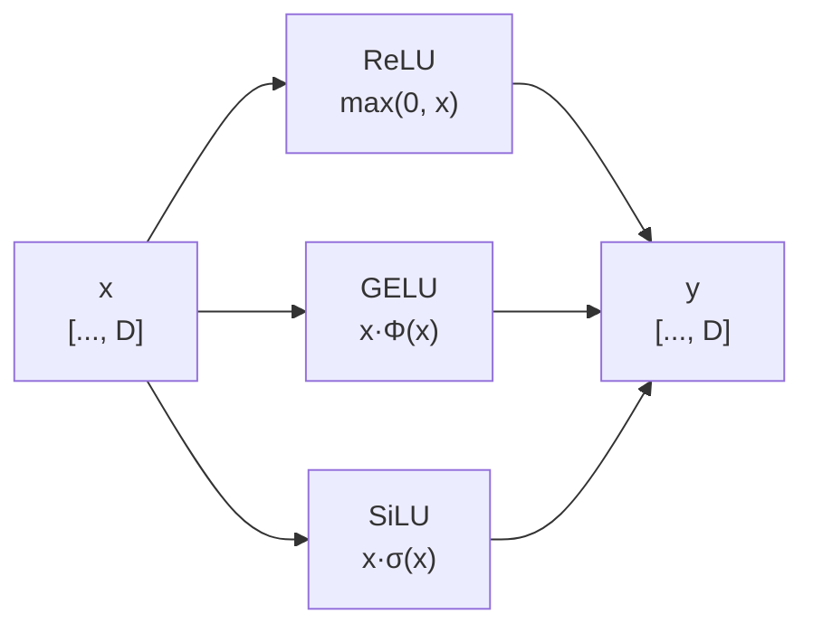

# 激活函数 (Activation Functions)

> ReLU / GELU / SiLU 及其梯度

## 📌 原理与思想

### 核心概念
激活函数引入非线性。ReLU 简单高效但有 dead neuron 问题；GELU 平滑更优（Transformer 常用）；SiLU/Swish 用于门控机制。`ReLU` 实现最便宜，`GELU`、`SiLU` 平滑、处处可导、训练更稳，代价是要算 exp 或 erf，比 `max` 贵一些。

### 核心思想
用一个逐元素的非线性函数把线性层的结果掰弯，让「多层」真正带来表达力 —— 没有激活函数时，多层线性变换叠起来仍然等价于单层线性变换。现代选择集中在平滑版 ReLU 上：负区间给一点非零梯度，避免神经元被永久关死。门控形式的 `x·σ(x)` 顺带把「通过多少」也变成可学的，这正是 SwiGLU 的基础。

### 算法步骤
1. `ReLU(x) = max(0, x)`：正区间导数恒为 1，负区间恒为 0。
2. `GELU(x) = x·Φ(x)`（`Φ` 是标准正态 CDF）：负区间仍有小梯度，是 ReLU 的平滑版。
3. `SiLU(x) = x·σ(x)`：`σ` 充当 0~1 的开关，负区间先降后回升，自带门控。
4. 三者都是逐元素作用，形状完全不变，可以随意替换。
5. 梯度的差别只有一档：`ReLU′` 只有 0 / 1 两档，在 0 处不连续；`GELU′`、`SiLU′` 处处可导 —— 这正是平滑版训练更稳的原因。

## 📐 核心公式

```math
\text{ReLU}(x)=\max(0,x),\qquad \text{ReLU}^{\prime}(x)=(x>0)
```

```math
\text{GELU}(x)=x\,\Phi(x),\qquad \Phi=\text{standard normal CDF}
```

```math
\text{SiLU}(x)=x\,\sigma(x),\qquad
\text{SiLU}^{\prime}(x)=\text{SiLU}(x)+\sigma(x)\left(1-\text{SiLU}(x)\right)
```

```math
\text{Swish}\equiv\text{SiLU}
```

## 📊 张量流程图



## 💻 代码实现

```python
import torch
import torch.nn as nn
import torch.nn.functional as F

def relu(x):
    return torch.clamp(x, min=0)

def gelu(x):
    return 0.5 * x * (1 + torch.tanh(
        (2/3.14159)**0.5 * (x + 0.044715 * x**3)
    ))

def silu(x):
    return x * torch.sigmoid(x)

def check_gradients():
    x = torch.linspace(-3, 3, 100, requires_grad=True)
    
    y_relu = relu(x).sum()
    y_relu.backward()
    print("ReLU grad:", x.grad[:5])
    relu_grad = x.grad.clone()
    x.grad.zero_()
    
    y_gelu = gelu(x).sum()
    y_gelu.backward()
    print("GELU grad:", x.grad[:5])
    x.grad.zero_()
    
    y_silu = silu(x).sum()
    y_silu.backward()
    print("SiLU grad:", x.grad[:5])
    silu_grad = x.grad.clone()
    
    xd = x.detach()
    safe = xd != 0
    d_relu = (xd > 0).float()
    print(f"ReLU′ 公式 vs autograd 最大误差: "
          f"{(d_relu[safe] - relu_grad[safe]).abs().max().item():.2e}")
    s = torch.sigmoid(xd)
    d_silu = silu(xd) + s * (1 - silu(xd))
    print(f"SiLU′ 公式 vs autograd 最大误差: {(d_silu - silu_grad).abs().max().item():.2e}")

class FFN_ReLU(nn.Module):
    def __init__(self, d_model, d_ff):
        super().__init__()
        self.w1 = nn.Linear(d_model, d_ff)
        self.w2 = nn.Linear(d_ff, d_model)
    
    def forward(self, x):
        return self.w2(F.relu(self.w1(x)))

class FFN_GELU(nn.Module):
    def __init__(self, d_model, d_ff):
        super().__init__()
        self.w1 = nn.Linear(d_model, d_ff)
        self.w2 = nn.Linear(d_ff, d_model)
    
    def forward(self, x):
        return self.w2(F.gelu(self.w1(x)))

class FFN_SwiGLU(nn.Module):
    def __init__(self, d_model, d_ff):
        super().__init__()
        self.w_gate = nn.Linear(d_model, d_ff, bias=False)
        self.w_up = nn.Linear(d_model, d_ff, bias=False)
        self.w_down = nn.Linear(d_ff, d_model, bias=False)
    
    def forward(self, x):
        gate = F.silu(self.w_gate(x))
        up = self.w_up(x)
        return self.w_down(gate * up)

# 测试
if __name__ == "__main__":
    check_gradients()
    
    for lim in (3, 10):
        xs = torch.linspace(-lim, lim, 2001)
        print(f"x∈[-{lim}, {lim}]：tanh 近似 vs F.gelu 最大误差 "
              f"{(gelu(xs) - F.gelu(xs)).abs().max().item():.2e}")
    
    import matplotlib.pyplot as plt
    
    x = torch.linspace(-3, 3, 100)
    
    plt.figure(figsize=(12, 4))
    
    plt.subplot(1, 3, 1)
    plt.plot(x.numpy(), relu(x).detach().numpy())
    plt.title('ReLU')
    plt.grid(True)
    
    plt.subplot(1, 3, 2)
    plt.plot(x.numpy(), gelu(x).detach().numpy())
    plt.title('GELU')
    plt.grid(True)
    
    plt.subplot(1, 3, 3)
    plt.plot(x.numpy(), silu(x).detach().numpy())
    plt.title('SiLU/Swish')
    plt.grid(True)
    
    plt.tight_layout()
    plt.savefig('activation_functions.png')
    print("Plot saved to activation_functions.png")
```

## 🎯 面试要点

- **ReLU**: 简单高效，但有 dead neuron (负区间梯度=0)
- **GELU**: 平滑版 ReLU，BERT/GPT 使用
- **SiLU = Swish**: 用于 SwiGLU 门控机制
- **面试常问**: 各激活函数的梯度和使用场景？
- **使用场景**: ReLU 是原始 Transformer FFN 的标配；GELU 用于 BERT、GPT-2/3；SiLU 用于 SwiGLU（LLaMA、PaLM）
- **对比**: ReLU vs GELU vs SiLU 的优缺点？


